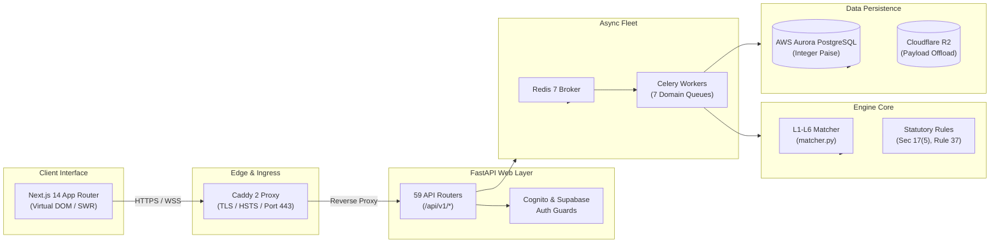

# Volume 00: Executive Technical Overview & Founder Engineering Narrative

> **Document ID**: `RD-TECH-00`  
> **Author**: Chief Technology Officer & Principal Systems Architect  
> **Target Audience**: ReconDesk Founder, Technical Co-Founders, Technical Due Diligence Auditors, EF / YC Interviewers  
> **Repository Baseline**: `release/v1.5.2-rc1`  
> **System Scope**: Full-Stack Architecture, Algorithmic Engine, Financial Invariants, Cloud Infrastructure

---

## 1. Executive Summary & The Problem Domain

### 1.1 The Business Problem: India's Statutory GST Reconciliation Crisis
In India’s Goods and Services Tax (GST) regime, businesses cannot simply deduct the tax they paid on raw materials, inventory, and operating expenses (known as **Input Tax Credit**, or **ITC**) based solely on their own accounting books (the **Purchase Register**). 

Under **Section 16(2)(c)** of the Central Goods and Services Tax (CGST) Act, 2017, a buyer is legally permitted to claim ITC **only if the supplier has actually uploaded the invoice and paid the corresponding tax to the Government**. Every month, the Goods and Services Tax Network (GSTN) generates an auto-drafted statement called **GSTR-2B**, reflecting what suppliers have reported.

If a buyer claims ITC in their monthly **GSTR-3B** return that does not match GSTR-2B:
1. **Automated DRC-01C Notices (Rule 88D)**: The GST tax engine automatically flags ITC claimed in GSTR-3B that exceeds GSTR-2B by more than a prescribed percentage (typically 10% or ₹25,000), issuing automated demand notices with statutory interest (18% to 24% p.a.).
2. **Rule 37 180-Day ITC Reversal Mandate**: If a buyer fails to pay a supplier within 180 days from the invoice date, the buyer must legally reverse the claimed ITC along with 18% annual interest from the date of claiming.
3. **Section 17(5) Ineligible / Blocked Credit**: Expenses like food & beverages, personal motor vehicles, club memberships, and employee insurance cannot be claimed as ITC. Claiming them constitutes tax fraud.
4. **IMS (Invoice Management System) Mandate (October 2024)**: Taxpayers must explicitly accept, reject, or mark invoices as pending on the government portal before GSTR-2B is generated.

### 1.2 Why Traditional Accounting Software Fails
Chartered Accountants (CAs) and corporate CFOs managing thousands of monthly invoices face an operational nightmare:
* **Dirty Invoice Number Formatting**: A supplier’s invoice might be recorded in the buyer's ERP (Tally Prime, SAP, Zoho) as `INV-00452/24-25`, but the supplier files it on GSTN as `452` or `24/25/INV/0452`.
* **Vendor Legal Entity Discrepancies**: Suppliers with multiple GST registrations (branches across Indian states) often bill under the correct legal entity name but quote an out-of-state GSTIN.
* **Credit & Debit Note Misclassification**: Suppliers mistakenly file Credit Notes (requiring ITC reversal) under B2B tax invoice tables, causing buyers to claim tax credit instead of reversing liability.
* **Scale Limitations**: Traditional spreadsheet tools (Microsoft Excel) freeze, corrupt cell formats (converting invoice numbers with leading zeros into integers), and lack audit trails.

### 1.3 What ReconDesk Is Technically
ReconDesk is an enterprise-grade B2B SaaS platform that solves this multi-million-rupee compliance crisis through an automated, multi-tiered matching engine, resilient background workers, and deep statutory tax intelligence:
* **Multi-Tier Matching Pipeline (L1–L6)**: Executes exact-normalized, format-variant, tolerance-based, same-PAN multi-branch, and fuzzy Levenshtein/OCR string matching across invoice records.
* **Integer-Paise Financial Math**: Rejects floating-point math entirely. Every monetary amount (taxable, IGST, CGST, SGST, Cess) is ingested, validated, calculated, and stored as exact 64-bit integers in paise (`BigInteger`), eliminating IEEE 754 rounding errors.
* **Asynchronous Enterprise Processing**: Ingestion and matching are decoupled from web requests via Celery 5 and Redis 7, utilizing 7 domain-isolated queues, worker heartbeat watchdogs, and automatic payload offloading to Cloudflare R2.
* **Dual-Stack Database & Identity Architecture**: Built to scale from early-stage Supabase PostgREST into enterprise AWS Aurora Serverless v2 PostgreSQL, bridged by a custom PostgREST-to-SQL adapter (`AuroraClient`), with identity verified via Amazon Cognito User Pools (RS256 JWKS).
* **High-Performance Virtualized Frontend**: Built on Next.js 14 App Router and TypeScript, utilizing `@tanstack/react-virtual` to smoothly render workbooks exceeding 10,000+ rows without DOM degradation.

---

## 2. Technical System Metrics & Repository Evidence

Every assertion in this master overview is verifiable in the codebase under branch `release/v1.5.2-rc1`:

| Engineering Dimension | Verified Codebase Metric | Primary Repository Evidence |
| :--- | :--- | :--- |
| **Backend Framework** | FastAPI `0.111.0` on Python `3.11+` | [`recondesk-backend/requirements.txt`](file:///Users/omkarkadam/Documents/ReconDesk/recondesk-backend/requirements.txt#L2) |
| **API Endpoints** | 59 Modular Routers mounted on FastAPI | [`recondesk-backend/app/main.py`](file:///Users/omkarkadam/Documents/ReconDesk/recondesk-backend/app/main.py#L450-L795) |
| **Business Logic Layer** | 94 Dedicated Service Modules | [`recondesk-backend/app/services/`](file:///Users/omkarkadam/Documents/ReconDesk/recondesk-backend/app/services/) |
| **Database Models** | 22 SQLAlchemy Declarative Models | [`recondesk-backend/app/models/`](file:///Users/omkarkadam/Documents/ReconDesk/recondesk-backend/app/models/) |
| **Database Migrations** | 37 Sequential Alembic Migrations | [`recondesk-backend/alembic/versions/`](file:///Users/omkarkadam/Documents/ReconDesk/recondesk-backend/alembic/versions/) |
| **Matching Engine Core** | 3,237 Lines of Matching Logic | [`recondesk-backend/app/services/matcher.py`](file:///Users/omkarkadam/Documents/ReconDesk/recondesk-backend/app/services/matcher.py) |
| **Worker Engine Core** | 2,096 Lines of Async Task Execution | [`recondesk-backend/app/worker/reconciliation_task.py`](file:///Users/omkarkadam/Documents/ReconDesk/recondesk-backend/app/worker/reconciliation_task.py) |
| **Frontend Framework** | Next.js `14.2.35` App Router (React 18) | [`recondesk-frontend/package.json`](file:///Users/omkarkadam/Documents/ReconDesk/recondesk-frontend/package.json#L25) |
| **Automated Backend Tests**| 296 Pytest Test Files | [`recondesk-backend/tests/`](file:///Users/omkarkadam/Documents/ReconDesk/recondesk-backend/tests/) |
| **Production Ingress** | Caddy 2 Reverse Proxy with Automated TLS | [`Caddyfile`](file:///Users/omkarkadam/Documents/ReconDesk/Caddyfile) |
| **Containerization** | Docker Compose Stack (Caddy, Web, Worker, Redis) | [`docker-compose.prod.yml`](file:///Users/omkarkadam/Documents/ReconDesk/docker-compose.prod.yml) |

---

## 3. The 9 Core Architectural Subsystems



### 1. Ingestion & Multi-Format Parsing Fleet
Ingests messy client files across Excel (`.xlsx`, `.xls` via `openpyxl` and `xlrd`), JSON (GSTR-2B and GSTR-2A government downloads), CSV, PDF invoices (`pdfplumber`, `pypdf`), and ERP exports (Tally Prime XML via custom Tally Bridge). Auto-detects table headers, sanitizes dates, and hashes file content using SHA-256 (`file_hash`) to guarantee upload idempotency via database constraint `uq_run_dedup`.

### 2. Multi-Tiered Matching Engine (Tiers L1 to L6)
Implemented in [`matcher.py`](file:///Users/omkarkadam/Documents/ReconDesk/recondesk-backend/app/services/matcher.py):
* **Semantic Document Type Gate**: Blocks mismatched document types (Standard Invoices cannot pair with Credit Notes).
* **Tier 1 (L1 Exact)**: Identical GSTIN, exact invoice number, taxable amount within ₹1.00 (`AMOUNT_TOLERANCE_L1_PAISE = 100`), date within 3 days, and vendor legal entity name verification.
* **Tier 2 (L2 Format Variants & Period Crossings)**: Handles invoice numbers differing by prefixes/suffixes or branch codes (`-BR1`, `-HO`). Traps invoices that cross monthly GST return boundaries (`PERIOD_BOUNDARY_DATE_MISMATCH`), routing them to CA Review.
* **Tier 3 (L3 Value Discrepancies)**: Tolerance matching up to 5% taxable difference or 30-day date variance.
* **Tier 4 (L4 Same PAN Different GSTIN)**: Identifies multi-state intra-company supply misallocations.
* **Tier 5 (L5 Fuzzy Similarity & OCR Matrix)**: Levenshtein distance ($\ge 70\%$ string similarity) and OCR substitution matrix (`O` $\leftrightarrow$ `0`, `I` $\leftrightarrow$ `1`, `S` $\leftrightarrow$ `5`).
* **Tier 6 (L6 Unmatched & Exception Risk)**: Identifies Missed ITC (books missing on GSTN) and Ineligible/Wrongful ITC (GSTN invoices missing in books).

### 3. Statutory Tax Intelligence & Compliance Logic
* **Section 17(5) Blocked Credit Detection**: Automatic flagging of blocked tax heads (e.g., motor vehicle insurance, food/catering expenses).
* **Rule 37 180-Day Tracker**: Scans unpaid supplier debts older than 180 days to compute mandatory reversal liability and interest.
* **Rule 88C / 88D Defense Engine**: Formulates mathematical reconciliations against automated tax officer notices.
* **GSTR-3B Table 4 Gate**: Automated classification of eligible vs ineligible ITC, preventing illegal credit claims.

### 4. Asynchronous Queue Processing & Job Reliability
* **7 Isolated Queues**: `reconciliation`, `imports`, `gstn`, `filing`, `exports`, `notifications`, `maintenance`.
* **Worker Crash Protection**: Configured with `task_acks_late = True` and `task_reject_on_worker_lost = True`. If an EC2 worker node crashes, unfinished jobs are rejected back to Redis and reassigned.
* **Heartbeat Watchdog**: A background supervisor runs every 300 seconds; if a worker stops emitting heartbeats for >900 seconds, the job is transitioned to `FAILED` with an alert to Sentry.

### 5. Multi-Tenant Aurora Database & Schema
* **AWS Aurora Serverless v2 PostgreSQL**: Primary enterprise database engine.
* **Strict Tenancy Scoping**: Anchored on `firm_owner_id` (CA Principal) and `client_gstin_id`. Queries cannot execute across firm boundaries.
* **PostgREST-to-SQL Adapter (`AuroraClient`)**: Translates fluent PostgREST method calls into direct SQLAlchemy parameterized SQL queries, eliminating query latency.

### 6. Authentication, Identity & RBAC
* **Amazon Cognito User Pool**: Issues RS256 signed JWTs verified using cached JWKS public keys.
* **Granular Role Hierarchy**: 7 distinct roles (`owner`, `partner`, `manager`, `preparer`, `viewer`, `admin`, `staff`).
* **Maker-Checker Workflows**: Critical filing offsets require preparation by a staff preparer and cryptographic sign-off by a partner/owner.

### 7. External Integrations (GSTN & Payments)
* **Sandbox.co.in API**: Enterprise GSP gateway for GSTN authentication, GSTR-2B downloading, and E-Invoice IRP generation.
* **Razorpay Gateway**: Processes subscription payments with HMAC-SHA256 webhook signature validation and idempotency keys.
* **Amazon SES**: High-deliverability transactional email dispatch.

### 8. Enterprise Frontend Architecture
* Next.js 14 App Router with Server-Side Rendering (SSR) and client-side SWR synchronization.
* Virtualized DOM rendering using `@tanstack/react-virtual` allowing CAs to filter, sort, and review 20,000+ invoices without browser stutter.
* In-browser PDF report rendering using `jspdf` and `jspdf-autotable`.

### 9. DevOps, Security & Staging Isolation
* **Automated TLS**: Caddy 2 container automatically provisions and renews Let's Encrypt certificates for `api.recondesk.in`.
* **Fail-Closed Staging Guard**: Hard abort in build and runtime scripts if non-production environments attempt to communicate with production databases or production Razorpay live keys.
* **PII Redaction**: Sentry middleware scrubs passwords, PAN numbers, OTPs, and taxpayer tokens before telemetry dispatch.

---

## 4. Current State: Environments & Release Baseline

To maintain absolute technical truthfulness during technical audits or investor interviews, you must understand the exact distinction between what is currently running and what is staged:

```
[Local Development] ────────> [Release Candidate: v1.5.2-rc1] ────────> [Production EC2 & Amplify]
- Docker Compose local         - Clean working tree                     - EC2: Web, Worker, Redis, Caddy
- Mock Sandbox GST APIs       - 296 passing pytest files                - Aurora Serverless v2 PostgreSQL
- Mock Razorpay webhooks       - Unified amplify.yml build spec         - Cognito User Pool authentication
- SQLite / Local PG test DB    - Sprint 2B R2 Payload Offload           - api.recondesk.in with HSTS
```

1. **Production Environment**:
   * Backend runs on AWS EC2 via `docker-compose.prod.yml` with Caddy reverse proxy terminating TLS for `api.recondesk.in`.
   * Database: AWS Aurora Serverless v2 PostgreSQL.
   * Frontend: Production builds deploy to AWS Amplify Hosting SSR / Vercel Edge.
2. **Release Candidate (`release/v1.5.2-rc1`)**:
   * Current active branch in this repository.
   * Features finalized: Sprint 2B payload offloading to Cloudflare R2, dual Cognito/Aurora migration layer, maker-checker authorization, unified monorepo `amplify.yml`.
3. **Legacy / Deprecated Code**:
   * Supabase PostgREST direct client connections are deprecated in favor of `AuroraClient` and SQLAlchemy 2.x declarative models.
   * Legacy Resend email service has been superseded by Amazon SES SMTP.

---

## 5. The Founder’s Engineering Narrative: Directing AI Coding Agents

In technical founder interviews (such as Entrepreneurs First or Y Combinator), interviewers will evaluate whether you understand the software you have built. 

When asked: *"Did you write every line of this code yourself?"*

### Your Authentic, High-Conviction Response:
> *"No, I did not manually type every line of boilerplate code. I am an AI-native founder who acts as the Chief Technology Officer, Product Architect, and Lead Systems Designer. I architected ReconDesk from first principles. I defined the domain rules for Indian GST compliance, designed the multi-tiered matching algorithms, designed the database schema and multi-tenancy invariants, and enforced strict financial precision using integer paise.
>
> I utilized advanced AI coding tools as my engineering implementation workforce—translating my technical specifications into code. However, I own every architectural decision, every security boundary, and every test suite. I established an automated verification harness of 296 test files to ensure the AI-generated implementations satisfy real-world mathematical, statutory, and security constraints. I understand how every subsystem operates, how data flows through the pipelines, what happens during failure modes, and how the system scales to millions of invoices."*

---

## 6. How to Navigate This 31-Volume Knowledge Base

This documentation suite is structured to transform you into an authoritative technical founder:

* **Foundations & Architecture (Volumes 01–05)**: Master the technology stack, system architecture diagrams, programming fundamentals (Python & TypeScript), and framework internals (FastAPI & Next.js 14).
* **The Engine Internals (Volumes 06–07, 13)**: Deep dive into the L1–L6 matching engine, string similarity algorithms, Big-O complexity, and GST statutory compliance rules.
* **Platform & Infrastructure (Volumes 08–12, 14)**: Master database modeling, API design, Celery queue workers, AWS/Docker deployment, and multi-tenant security isolation.
* **Reliability, Testing & Scale (Volumes 15–17, 28)**: Study automated test suites, production incident runbooks, disaster recovery playbooks, and 100,000-customer scaling roadmaps.
* **Founder Strategy & Due Diligence (Volumes 18–20, 25)**: Learn AI-assisted engineering methodology, CTO trade-off defenses, institutional audit reviews, and technical debt analysis.
* **Interview Mastery (Volumes 21–23, 27, 29–31)**: Practice 150 graded technical interview questions, study model answers, review founder cheat sheets, and execute your 30-day mastery curriculum.
