# Volume 02: Complete System Architecture & Operational Workflows

> **Document ID**: `RD-TECH-02`  
> **Author**: Chief Technology Officer & Principal Systems Architect  
> **Target Audience**: ReconDesk Founder, System Architects, Security Reviewers, EF / YC Technical Interviewers  
> **Repository Baseline**: `release/v1.5.2-rc1`  
> **Verification Standards**: Every diagram and sequence corresponds directly to source code in `recondesk-backend/app/`, `recondesk-frontend/`, and deployment specifications.

---

## 1. Architectural Principles & Invariants

ReconDesk is engineered around **five non-negotiable architectural invariants**:
1. **Zero Floating-Point Financial Arithmetic**: All monetary quantities (taxable amount, CGST, SGST, IGST, Cess, differences) are ingested, computed, compared, and stored as 64-bit integer paise (`BigInteger`). 
2. **Decoupled Asynchronous Processing**: No long-running calculation or external government network call occurs in the HTTP request-response cycle. Heavy operations are dispatched to Celery background workers across 7 isolated queues.
3. **Strict Tenancy Boundaries**: Every database query and business transaction is anchored to `firm_owner_id` (the CA Principal) and scoped to `client_gstin_id`. Cross-tenant data leakage is prevented at both the application repository layer and foreign key constraints.
4. **Idempotent Ingestion & Duplicate Protection**: Ingestion pipelines hash file contents (`file_hash`) and enforce database uniqueness constraints (`uq_run_dedup`), ensuring duplicate uploads cannot corrupt ledger states.
5. **Fail-Closed Security & Trust Boundaries**: Unauthenticated requests, missing authorization roles, or staging environments attempting to access production assets trigger immediate, automated aborts.

---

## 2. The 14 Comprehensive Architecture Diagrams

---

### Diagram A: High-Level Overall System Architecture

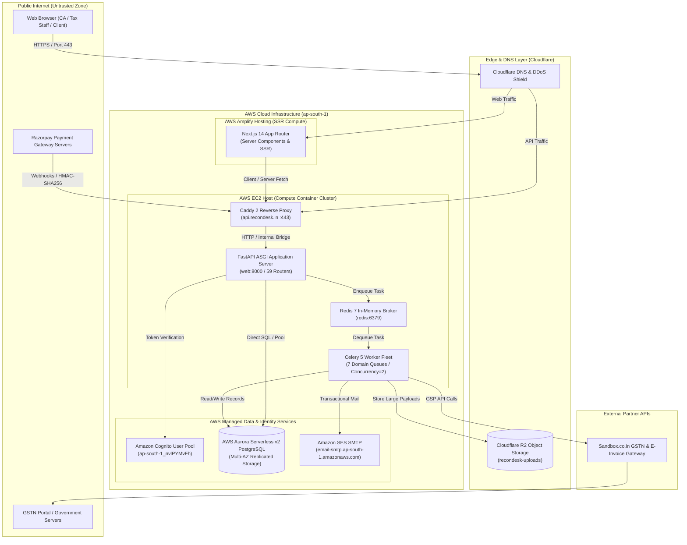

#### Node & Flow Analysis:
* **Trust Boundaries**: Public Internet is untrusted. Caddy 2 terminates TLS, enforcing HSTS preload. The communication between Caddy, FastAPI, Redis, and Celery is strictly private inside Docker’s bridge network on EC2.
* **Sensitive Financial Data**: Invoices move from Browser $\rightarrow$ FastAPI $\rightarrow$ Celery $\rightarrow$ Aurora DB. Large result payloads are encrypted in transit and offloaded to Cloudflare R2 (`reconciliation-payloads/`).
* **Points of Failure**: If Redis restarts, unacknowledged tasks persist on disk via `dump.rdb` or re-enqueue automatically. If Aurora fails over, SQLAlchemy recycles connections within 1,800s.

---

### Diagram B: Frontend Architecture (Next.js 14 App Router)

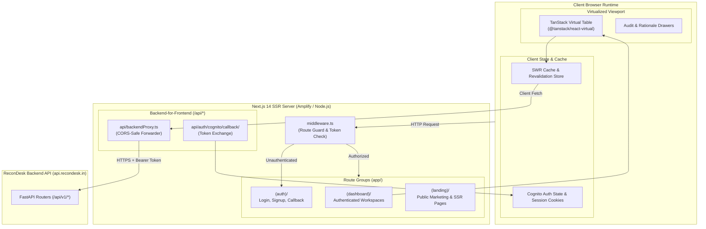

#### Node & Flow Analysis:
* **Rendering Strategy**: Landing pages use Server-Side Rendering (SSR) for SEO. Dashboard workspaces are Client Components (`"use client"`) using SWR for optimistic UI updates.
* **Large Table Rendering**: [`ReconcileTableVirtual.tsx`](file:///Users/omkarkadam/Documents/ReconDesk/recondesk-frontend/components/reconcile/) mounts `@tanstack/react-virtual` to calculate DOM row slices based on scroll offsets.
* **Points of Failure**: Token expiration triggers an automatic redirect to `/auth/login` via `middleware.ts`. Network timeouts trigger SWR retries with exponential backoff.

---

### Diagram C: Backend Architecture (FastAPI & Services)

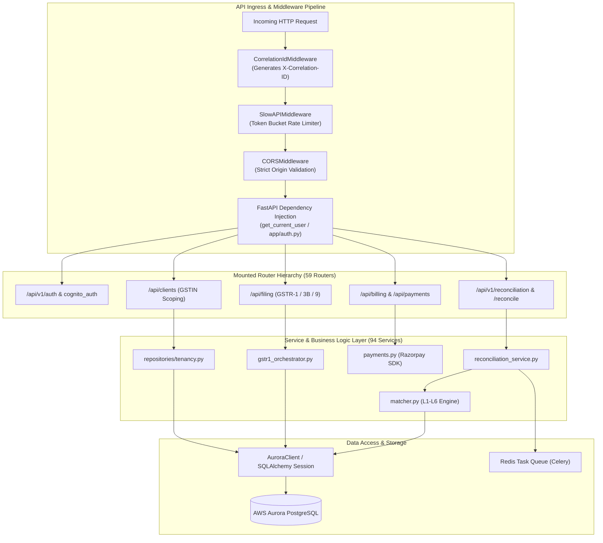

#### Node & Flow Analysis:
* **Request Lifecycle**: Every request passes through `CorrelationIdMiddleware` $\rightarrow$ `SlowAPIMiddleware` $\rightarrow$ `CORSMiddleware` $\rightarrow$ Route Dependency (`get_current_user`).
* **Dependency Injection**: Routes inject database sessions (`get_supabase` / `AuroraClient`) and authenticated user profiles (`AuthenticatedUser`), preventing shared mutable state across threads.
* **Points of Failure**: If an unhandled exception occurs, the global exception handler in [`main.py`](file:///Users/omkarkadam/Documents/ReconDesk/recondesk-backend/app/main.py#L430-L448) catches it, records the stack trace to Sentry, and returns a standard JSON error response (`HTTP 500`).

---

### Diagram D: Database Architecture & Multi-Tenancy Scoping

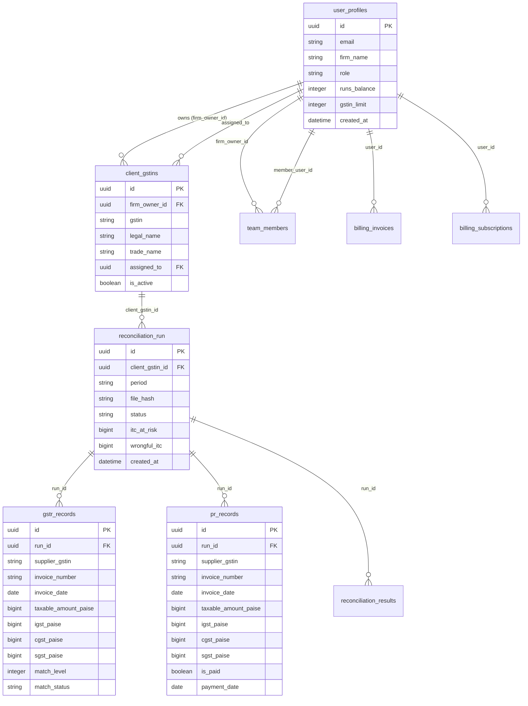

#### Node & Flow Analysis:
* **Primary Tenancy Anchor**: `user_profiles.id` is the root anchor for the CA Firm.
* **Cascade Deletions**: Deleting a `reconciliation_run` cascades to delete associated `gstr_records`, `pr_records`, and `reconciliation_results` via foreign key `ON DELETE CASCADE`.
* **Points of Failure**: Inadvertent queries omitting `firm_owner_id` or `client_gstin_id` are caught by repository tests ([`test_aurora_tenancy.py`](file:///Users/omkarkadam/Documents/ReconDesk/recondesk-backend/tests/test_aurora_tenancy.py)).

---

### Diagram E: Authentication & Authorization Lifecycle

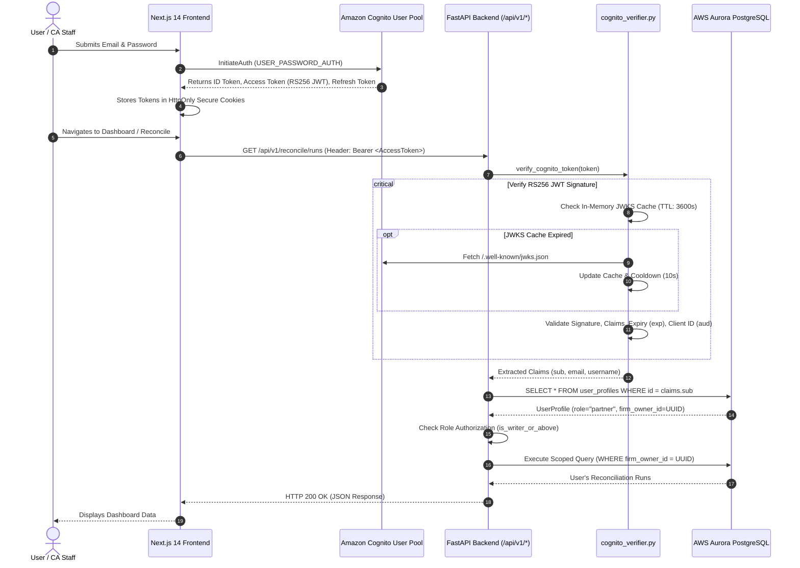

#### Node & Flow Analysis:
* **Cryptographic Verification**: Tokens are verified locally using Cognito’s RS256 public key bundle (`jwks.json`), preventing network round-trips on every API call.
* **Fail-Closed RBAC**: If a user’s role is unrecognized or missing, [`roles.py`](file:///Users/omkarkadam/Documents/ReconDesk/recondesk-backend/app/models/roles.py#L78) assigns `DEFAULT_FAIL_CLOSED_ROLE = "viewer"`, strictly revoking write/filing permissions.

---

### Diagram F: File Upload & Ingestion Pipeline

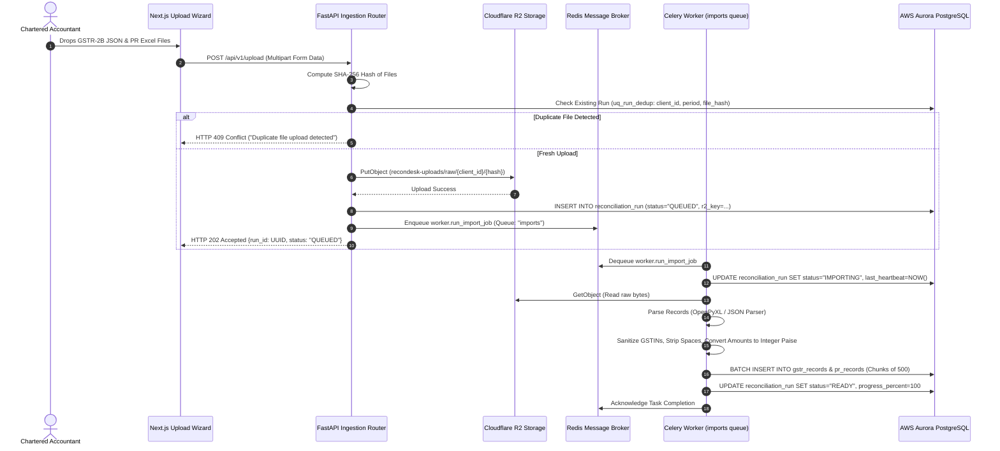

#### Node & Flow Analysis:
* **Deduplication**: `file_hash` prevents duplicate processing of identical client files.
* **Batch Inserts**: Ingested records are inserted in parameterized chunks of 500 rows to optimize database transaction buffers and avoid statement timeouts.

---

### Diagram G: Celery & Redis Background Processing Pipeline

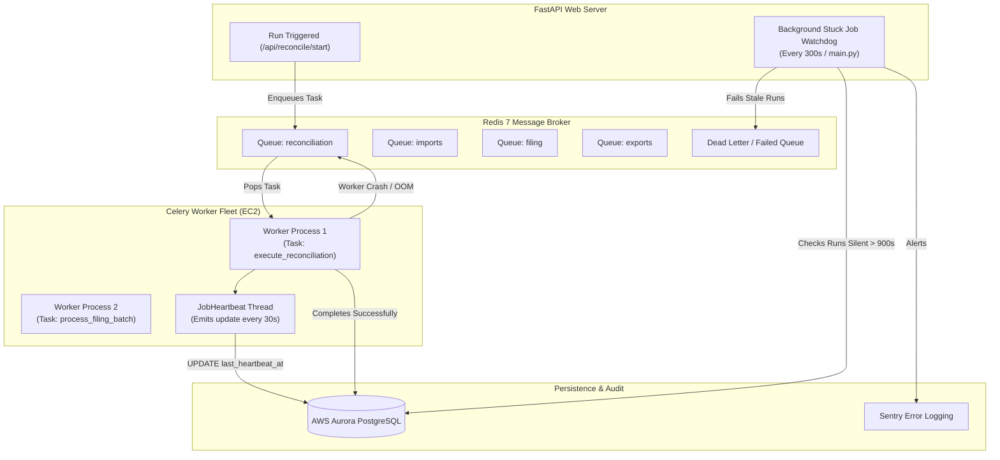

#### Node & Flow Analysis:
* **Queue Routing**: `TASK_ROUTES` routes tasks strictly to designated queues, isolating reconciliation traffic from export and filing pipelines.
* **Worker Crash Resilience**: `task_acks_late=True` ensures tasks are returned to the queue if the process crashes before completion.

---

### Diagram H: GSTN & External API Integration Pipeline

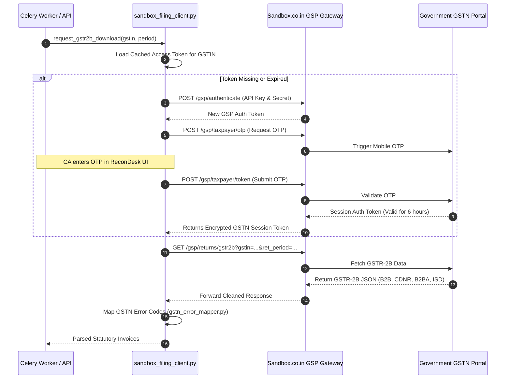

#### Node & Flow Analysis:
* **Token Security**: GSTN access tokens have a maximum validity of 6 hours. Tokens are stored encrypted in `client_gstins.gstn_access_token`.
* **Error Resilience**: Network timeouts or transient GSTN 502 Bad Gateway responses are mapped through [`gstn_error_mapper.py`](file:///Users/omkarkadam/Documents/ReconDesk/recondesk-backend/app/integrations/gstn_error_mapper.py) and retried with exponential jitter.

---

### Diagram I: Report Generation & Download Pipeline

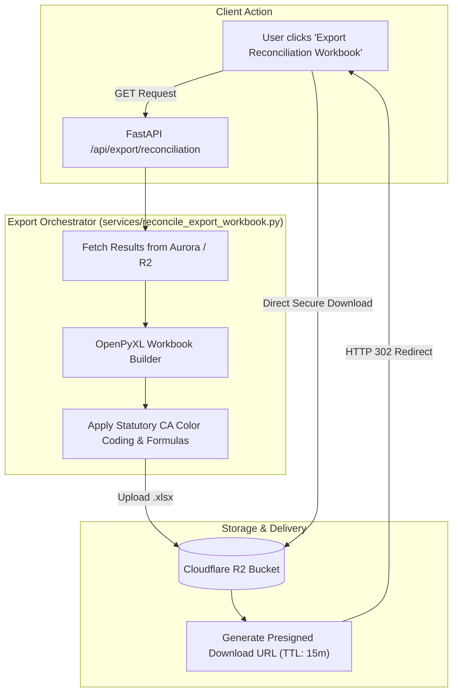

#### Node & Flow Analysis:
* **Color Coding**: Excel workbooks generated via `reconcile_export_workbook.py` follow standardized CA audit palettes (Green for L1 Exact, Amber for Review, Red for Ineligible / At-Risk).
* **Streaming Delivery**: Workbooks are uploaded directly to Cloudflare R2 and served via short-lived presigned URLs, avoiding buffer bloat in the FastAPI web server.

---

### Diagram J: Payment & Subscription Lifecycle

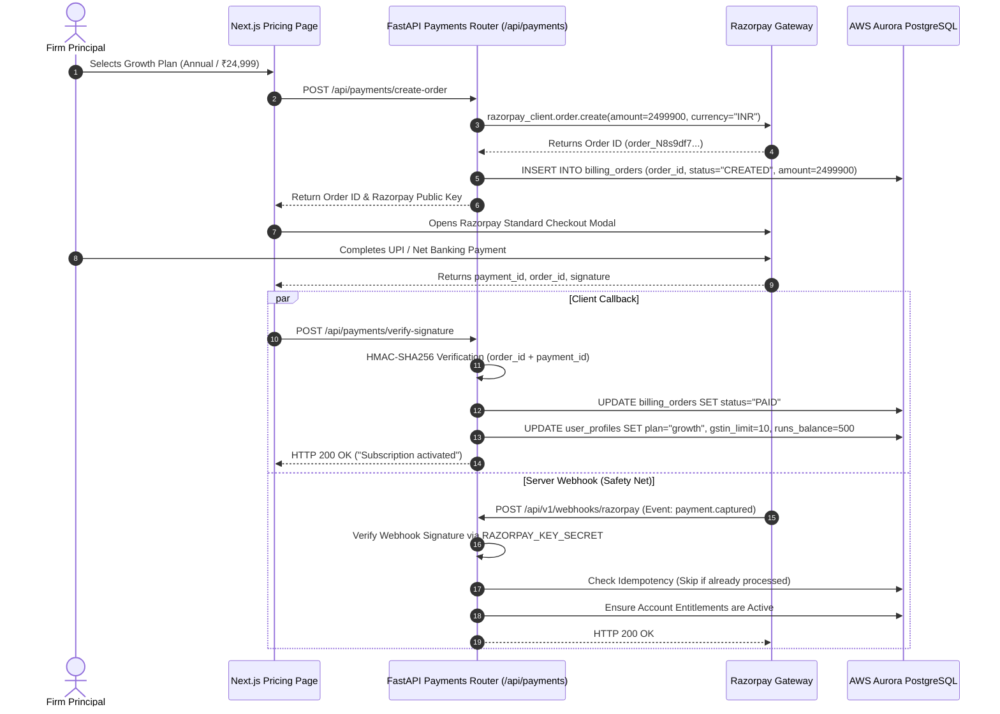

#### Node & Flow Analysis:
* **Double Verification**: Payments are verified both via the client checkout callback and an authoritative server-to-server webhook, preventing lost subscriptions if a user closes the browser mid-checkout.
* **Idempotency**: Webhook events check order statuses before updating balances, preventing duplicate credit allocation.

---

### Diagram K: AWS Infrastructure & Production Deployment

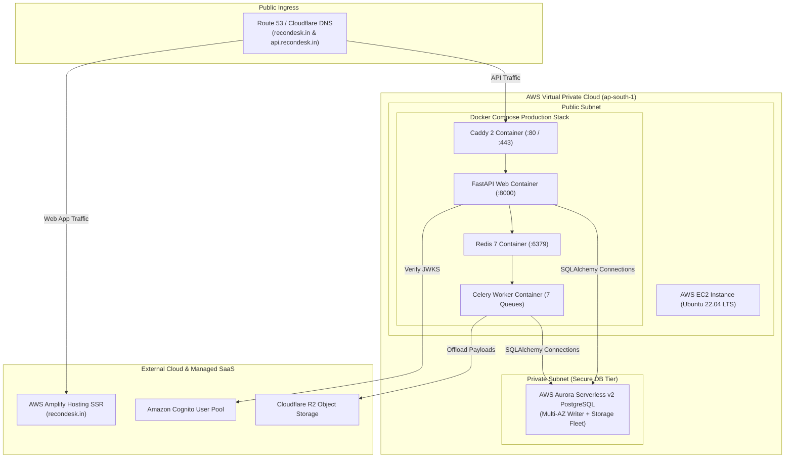

#### Node & Flow Analysis:
* **Network Isolation**: Aurora PostgreSQL resides in private database subnets, accessible only from the EC2 instance’s private IP via security group rules.
* **Storage Reliability**: Caddy configurations and Redis snapshots persist to mounted Docker volumes (`caddy_data`, `redis_data`).

---

### Diagram L: Monitoring, Error Handling & Disaster Recovery

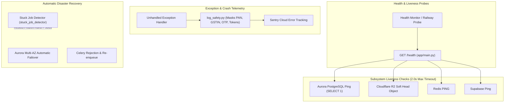

#### Node & Flow Analysis:
* **Fast Probing**: [`/health`](file:///Users/omkarkadam/Documents/ReconDesk/recondesk-backend/app/main.py#L803-L920) executes all checks via `asyncio.wait_for()` with a strict 2.0-second timeout, preventing hanging probes during upstream outages.
* **Zero PII Exposure**: Telemetry sent to Sentry is scrubbed of all Indian tax identifiers, banking details, and credentials.

---

### Diagram M: Multi-Tenant Data Isolation & Security Boundaries

```mermaid
flowchart TD
    subgraph UserContext ["User Authentication Context"]
        UserA["CA Firm A (firm_owner_id: UUID_A)"]
        UserB["CA Firm B (firm_owner_id: UUID_B)"]
    end

    subgraph APISecurityBoundary ["FastAPI Security Enforcement Layer"]
        Dep["get_current_user Dependency"]
        TenantGuard["Tenancy Guard: Enforces firm_owner_id scoping"]
    end

    subgraph AuroraDatabase ["AWS Aurora Database (Shared Multi-Tenant Storage)"]
        subgraph TenantAData ["Firm A Partition / Scoped Rows"]
            GSTINA["Client GSTINs (firm_owner_id = UUID_A)"]
            RunsA["Reconciliation Runs (client_gstin_id IN GSTINA)"]
            RecordsA["GSTR & PR Invoices (run_id IN RunsA)"]
        end

        subgraph TenantBData ["Firm B Partition / Scoped Rows"]
            GSTINB["Client GSTINs (firm_owner_id = UUID_B)"]
            RunsB["Reconciliation Runs (client_gstin_id IN GSTINB)"]
            RecordsB["GSTR & PR Invoices (run_id IN RunsB)"]
        end
    end

    UserA --> Dep
    UserB --> Dep
    Dep --> TenantGuard
    TenantGuard -->|Strictly Routes Query| TenantAData
    TenantGuard -.->|BLOCKS Cross-Tenant Access (HTTP 403 / 404)| TenantBData
```

#### Node & Flow Analysis:
* **Authorization Predicate**: Every query joining `reconciliation_run` must join `client_gstins` and match `firm_owner_id = current_user.firm_owner_id`.
* **IDOR Prevention**: An attacker attempting to view Run `UUID_X` belonging to another firm receives an immediate HTTP 404 Not Found or HTTP 403 Forbidden.

---

### Diagram N: External Service Dependencies & Failure Matrix

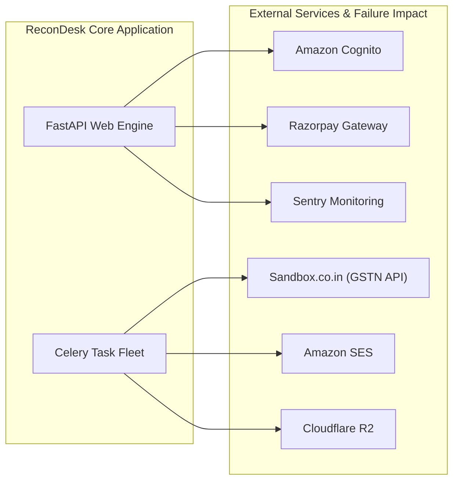

#### Dependency Failure Mitigation Table:

| External Service | Operational Role | Consequence If Down | Automated Fallback / Mitigation |
| :--- | :--- | :--- | :--- |
| **Sandbox.co.in** | GSTN & E-Invoice Gateway | GSTR-2B autofetch & filing fails | Fallback to manual Excel/JSON file upload; user notification |
| **Amazon Cognito** | Authentication & Identity | Logins & token refreshes fail | Cached JWKS verification keeps existing active sessions alive |
| **Cloudflare R2** | Upload & Payload Storage | Large result payloads cannot save | Fallback to direct Aurora database JSONB storage (`RECONCILIATION_PAYLOAD_STORAGE=auto`) |
| **Razorpay** | Subscription Payments | Upgrades & checkouts fail | Existing paid subscriptions remain active until expiration |
| **Amazon SES** | Email Notifications | Email alerts delayed | Fallback to Resend SDK or background queue retry with backoff |
| **Sentry** | Error Telemetry | Telemetry dropped | Non-blocking execution; platform operates normally |

---

## 3. Architecture Interview Questions & Exercises

### 3.1 Self-Testing Questions for the Founder
1. **Trace the exact path of an invoice number from the moment a user uploads an Excel file to its storage in Aurora.** Which components touch it?
2. **What prevents an API thread from locking up when a user uploads a 50,000-line workbook?**
3. **How does ReconDesk guarantee that Firm A cannot inspect Firm B's reconciliation data?**
4. **Explain how the Celery heartbeat watchdog works.** What triggers a job status change to `FAILED`?
5. **Why does ReconDesk offload large match results to Cloudflare R2 instead of storing them directly in PostgreSQL?**

### 3.2 Practical Verification Exercises
* **Exercise 1 (Mermaid Verification)**: Review Diagram E (Authentication). Trace lines 15–22 in [`recondesk-backend/app/auth.py`](file:///Users/omkarkadam/Documents/ReconDesk/recondesk-backend/app/auth.py) and confirm the JWKS caching logic.
* **Exercise 2 (Payload Storage Inspection)**: Open [`recondesk-backend/app/services/reconciliation_payload_store.py`](file:///Users/omkarkadam/Documents/ReconDesk/recondesk-backend/app/services/reconciliation_payload_store.py) and identify the threshold where a match payload is offloaded to Cloudflare R2.
