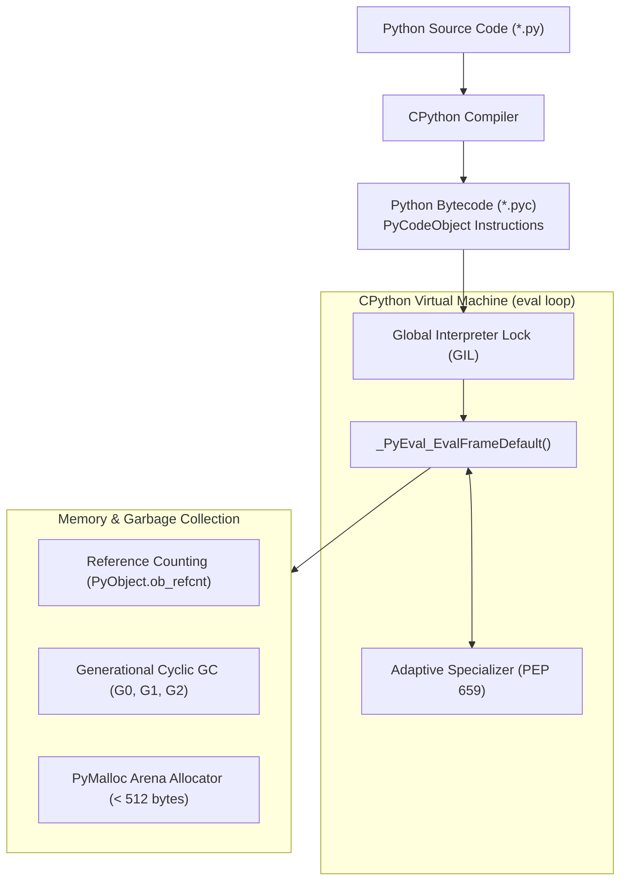

# Volume 04: Python Backend Deep Dive & Framework Internals

> **Document ID**: `RD-TECH-04`  
> **Author**: Chief Technology Officer & Principal Systems Architect  
> **Target Audience**: ReconDesk Founder, Senior Python Engineers, Backend Architects, EF / YC Technical Interviewers  
> **Repository Baseline**: `release/v1.5.2-rc1`  
> **Primary Source Evidence**: [`recondesk-backend/app/main.py`](file:///Users/omkarkadam/Documents/ReconDesk/recondesk-backend/app/main.py), [`app/config.py`](file:///Users/omkarkadam/Documents/ReconDesk/recondesk-backend/app/config.py), [`app/database.py`](file:///Users/omkarkadam/Documents/ReconDesk/recondesk-backend/app/database.py), [`app/dependencies.py`](file:///Users/omkarkadam/Documents/ReconDesk/recondesk-backend/app/dependencies.py), [`app/models/base.py`](file:///Users/omkarkadam/Documents/ReconDesk/recondesk-backend/app/models/base.py).

---

## 1. Executive Summary & Runtime Architecture

The ReconDesk backend runs on **Python 3.11** under Debian Linux containerization (`python:3.11-slim-bookworm`). It employs **FastAPI** as its web framework, **Uvicorn** as its ASGI HTTP server, **Pydantic v2** for data validation, and **SQLAlchemy 2.0** for database interaction.

### Key Performance Innovations in Python 3.11:
Python 3.11 introduced the **Faster CPython Project**, achieving a **25% to 40% performance improvement** over Python 3.10 through:
1. **Specializing Adaptive Interpreter**: Bytecode instructions that operate on predictable types (e.g., adding two integers in an invoice loop) are dynamically replaced at runtime with specialized, single-CPU-instruction bytecodes (`BINARY_OP_ADD_INT`), bypassing general-purpose type checks.
2. **Zero-Cost Exception Handling**: When code executes without errors, `try/except` blocks incur **zero runtime CPU overhead** because exception handler tables are stored outside the active instruction path.
3. **Inlined Python Function Calls**: Eliminates C call stack frame creation for simple Python functions, dramatically accelerating high-frequency normalization routines.

---

## 2. CPython Internals: Memory, Bytecode & The GIL



---

### 2.1 The Global Interpreter Lock (GIL)
* **What is it?**: A mutex (mutual exclusion lock) that protects access to Python objects, preventing multiple native operating system threads from executing Python bytecode simultaneously.
* **Why it matters in ReconDesk**: Because of the GIL, a multi-threaded Python process cannot achieve true multi-core CPU parallelism for mathematical calculations. 
* **The ReconDesk Architectural Solution**: 
  * For **I/O-bound concurrency** (handling thousands of simultaneous incoming HTTP connections), we use FastAPI’s asynchronous event loop (`asyncio`), which runs on a single thread and switches tasks during I/O wait states.
  * For **CPU-bound parallelism** (matching 50,000 invoices), we spawn **separate Celery worker processes** (`--concurrency=2`). Each process has its own independent Python interpreter, its own memory heap, and its own GIL, achieving true hardware parallelism across all available CPU cores on our AWS EC2 instance.

---

### 2.2 Memory Management & Garbage Collection
Every Python object carries a header:
```c
struct _object {
    _PyObject_HEAD_EXTRA
    Py_ssize_t ob_refcnt;          // Reference counter
    struct _typeobject *ob_type;    // Pointer to type object
};
```
* **Reference Counting**: Whenever a variable references an object (e.g. `pr = record`), `ob_refcnt` increments by 1. When the variable goes out of scope, `ob_refcnt` decrements. When it hits zero, Python immediately deallocates the memory back to the `PyMalloc` memory arena.
* **Generational Garbage Collection**: Reference counting alone cannot clean up **reference cycles** (e.g. Object A references Object B, and Object B references Object A). Python's cyclic garbage collector groups objects into three generations (**Gen 0, Gen 1, Gen 2**). New objects start in Gen 0. If they survive a GC cycle, they are promoted to Gen 1, and eventually Gen 2. ReconDesk minimizes cyclic references by using immutable dataclasses (`@dataclass(frozen=True)`) and plain dictionaries for invoice representations.

---

## 3. FastAPI Internals: The Request Processing Pipeline

* **Source Location**: [`recondesk-backend/app/main.py`](file:///Users/omkarkadam/Documents/ReconDesk/recondesk-backend/app/main.py#L346-L402)

### 3.1 The Application Lifespan (`@asynccontextmanager`)
In modern ASGI architecture, startup and shutdown events are managed via an asynchronous context manager (`lifespan`). This guarantees clean resource allocation and graceful teardown:

```python
@asynccontextmanager
async def lifespan(app: FastAPI):
    _log.info("Startup: Beginning application startup sequence...")

    # 0. Fail-closed staging guard
    if (settings.APP_ENV or "").lower() == "staging":
        enforce_staging_safety(settings)

    # 1. Verify database connectivity with 10s timeout
    await asyncio.wait_for(asyncio.to_thread(_verify_database_connection), timeout=10.0)

    # 2. Run Alembic database migrations to head
    await asyncio.to_thread(_run_alembic_upgrade)

    # 3. Spawn background supervisor tasks
    task = asyncio.create_task(stuck_job_detector())
    
    yield  # Server begins accepting traffic
    
    # Graceful Shutdown
    task.cancel()
    _log.info("Shutdown: Application shutdown complete.")
```

#### Why `yield` is Revolutionary:
Code before the `yield` statement runs **before** the server opens its listening port. If the database connection fails or Alembic migrations fail, the server crashes immediately (failing closed) rather than accepting incoming user requests that would fail with HTTP 500. Code after `yield` executes when the server receives a `SIGTERM` or `SIGINT`, cleanly terminating background tasks without dropping in-flight database transactions.

---

### 3.2 Starlette Routing & Radix Trees
FastAPI routes are evaluated using Starlette’s routing tree. Routers mounted with prefixes (e.g. `/api/v1/reconciliation`) are compiled into a **Radix Tree** (prefix tree). When a request hits `/api/v1/reconciliation/start`, the router performs prefix lookups in $O(K)$ time (where $K$ is the number of path segments), routing the request in sub-microsecond time.

---

## 4. Pydantic v2 & The Rust Validation Engine (`pydantic-core`)

In ReconDesk, every incoming JSON request and outgoing response is validated by Pydantic v2.

### 4.1 Pydantic v1 vs Pydantic v2 Architecture:
* **Pydantic v1**: Built in pure Python. Validating complex nested schemas with thousands of invoice items took hundreds of milliseconds, creating a CPU bottleneck.
* **Pydantic v2**: The validation core (`pydantic-core`) was completely rewritten in **Rust**. Python type annotations are compiled into a C-level validation state machine, resulting in a **5x to 20x performance speedup**.

### 4.2 Strict Schema Modeling in ReconDesk
From [`recondesk-backend/app/models/base.py`](file:///Users/omkarkadam/Documents/ReconDesk/recondesk-backend/app/models/base.py):

```python
class StrictModel(BaseModel):
    """Base Pydantic model enforcing strict validation and immutability."""
    model_config = ConfigDict(
        extra="forbid",           # Forbids unknown/unrecognized fields
        str_strip_whitespace=True,# Strips leading/trailing whitespace automatically
        validate_assignment=True, # Validates types even on attribute assignment
        frozen=False,
    )
```

#### The Security Rationale of `extra="forbid"`:
By default, standard Pydantic models ignore extra fields in a JSON body. If an attacker submits `{ "email": "user@example.com", "role": "owner" }`, a naive model silently accepts the payload and ignores `role`. By setting `extra="forbid"`, the API immediately raises an HTTP 422 Unprocessable Entity error if an adversary attempts to inject unauthorized administrative attributes, eliminating **mass-assignment vulnerabilities**.

---

## 5. Dependency Injection Architecture & Scope Management

* **Source Location**: [`dependencies.py`](file:///Users/omkarkadam/Documents/ReconDesk/recondesk-backend/app/dependencies.py) and [`auth.py`](file:///Users/omkarkadam/Documents/ReconDesk/recondesk-backend/app/auth.py)

### 5.1 How FastAPI Dependency Resolution Works:
When an endpoint is defined:
```python
@router.get("/runs")
async def list_runs(
    current_user: AuthenticatedUser = Depends(get_current_active_user),
    db: Any = Depends(get_db),
):
```
FastAPI constructs a **Directed Acyclic Graph (DAG)** of all dependencies:
```
           HTTP Request Headers
                    │
                    ▼
          bearer_scheme (HTTPBearer)
                    │
                    ▼
          get_current_user
                    │
                    ▼
          get_current_active_user
                    │
                    ▼
        Endpoint Function: list_runs()
```
* **Sub-Dependency Resolution**: `get_current_active_user` internally depends on `get_current_user`, which depends on `bearer_scheme`. FastAPI resolves the entire tree automatically.
* **Dependency Caching (`use_cache=True`)**: If three different dependencies in the same request require `get_settings()`, FastAPI executes `get_settings()` exactly once, caching the result in the request's internal context and injecting the cached instance into all three dependents.

---

## 6. SQLAlchemy 2.0: Unit of Work & Connection Lifecycle

### 6.1 Declarative 2.0 Mapping:
In SQLAlchemy 2.0, model attributes are mapped explicitly using typed constructs, removing ambiguity between Python types and SQL column types:
```python
class ReconciliationRun(Base):
    __tablename__ = "reconciliation_run"
    
    id: Mapped[uuid.UUID] = mapped_column(GUID(), primary_key=True, default=uuid.uuid4)
    client_gstin_id: Mapped[uuid.UUID] = mapped_column(ForeignKey("client_gstins.id"))
    itc_at_risk: Mapped[int] = mapped_column(BigInteger, default=0)
```

### 6.2 The Identity Map & Unit of Work Pattern:
* **Identity Map**: Inside a single database session, querying an entity twice by its primary key returns the **exact same Python object in memory**:
  ```python
  run1 = session.query(ReconciliationRun).get(run_id)
  run2 = session.query(ReconciliationRun).get(run_id)
  assert run1 is run2  # True: identical memory address
  ```
* **Unit of Work**: When you modify an object (`run.status = "COMPLETED"`), SQLAlchemy does not immediately execute an `UPDATE` SQL statement. It tracks the change in its internal change-tracker. When `session.commit()` is called, SQLAlchemy computes the minimal set of SQL updates required, opens a transaction, executes the batch, and commits atomically.

---

## 7. Python Backend Interview Questions & Exercises

### 7.1 Founder Self-Testing Questions
1. **Explain what the Global Interpreter Lock (GIL) is in Python.** How does ReconDesk achieve true multi-core CPU parallelism despite the GIL?
2. **Why did ReconDesk adopt Pydantic v2?** What engineering advantages does `pydantic-core` (Rust) provide for financial data ingestion?
3. **What is the significance of the `@asynccontextmanager` lifespan in `main.py`?** What happens if the database connection fails before the `yield` statement?
4. **How does setting `extra="forbid"` on Pydantic models protect against mass-assignment security vulnerabilities?**
5. **Explain the difference between reference counting and generational garbage collection in CPython.**

### 7.2 Practical Verification Exercises
* **Exercise 1 (Bytecode Inspection)**: Write a 3-line function that adds two numbers. Use Python’s built-in `dis` module (`import dis; dis.dis(my_func)`) to inspect the compiled bytecode instructions.
* **Exercise 2 (Pydantic Extra Fields Test)**: In a local Python shell, create a Pydantic model with `model_config = ConfigDict(extra="forbid")`. Pass an unexpected dictionary key into the model. Verify that it raises a `ValidationError`.
