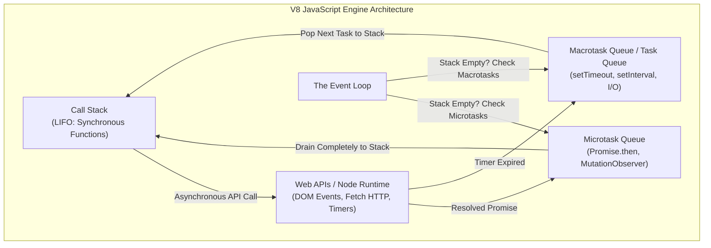
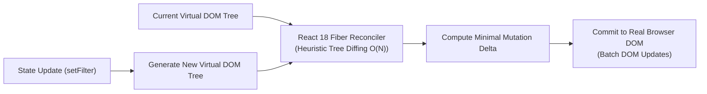
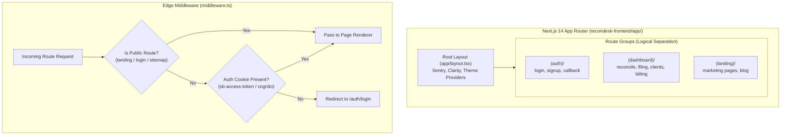
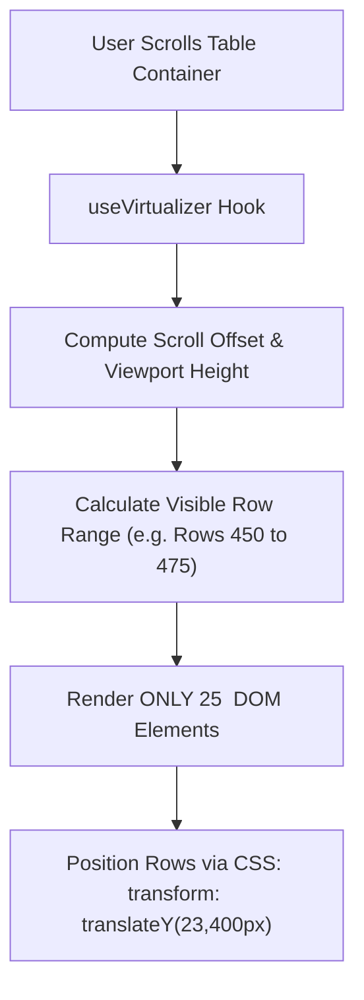

# Volume 05: TypeScript, React 18 & Next.js 14 App Router Architecture

> **Document ID**: `RD-TECH-05`  
> **Author**: Chief Technology Officer & Principal Systems Architect  
> **Target Audience**: ReconDesk Founder, Lead Frontend Engineers, Full-Stack Architects, EF / YC Technical Interviewers  
> **Repository Baseline**: `release/v1.5.2-rc1`  
> **Primary Source Evidence**: [`recondesk-frontend/package.json`](file:///Users/omkarkadam/Documents/ReconDesk/recondesk-frontend/package.json), [`middleware.ts`](file:///Users/omkarkadam/Documents/ReconDesk/recondesk-frontend/middleware.ts), [`app/layout.tsx`](file:///Users/omkarkadam/Documents/ReconDesk/recondesk-frontend/app/layout.tsx), [`lib/api.ts`](file:///Users/omkarkadam/Documents/ReconDesk/recondesk-frontend/lib/api.ts) (203 KB), [`components/reconcile/`](file:///Users/omkarkadam/Documents/ReconDesk/recondesk-frontend/components/reconcile/).

---

## 1. Executive Summary & Frontend Philosophy

The ReconDesk frontend is an enterprise web application designed to handle complex tabular datasets with sub-second responsiveness. Built on **Next.js 14.2 App Router**, **React 18**, and **TypeScript 5**, the frontend architecture balances two competing requirements:
1. **High-Performance Public Pages**: Fast initial load and SEO indexing for public landing pages via **Server-Side Rendering (SSR)**.
2. **Dense, Interactive Workspaces**: Desktop-grade data density for Chartered Accountants reviewing 25,000+ invoice rows with zero browser lag, achieved via **DOM Virtualization** (`@tanstack/react-virtual`) and **Reactive Client Caching** (`swr`).

---

## 2. JavaScript Event Loop & TypeScript Type System



---

### 2.1 The JavaScript Event Loop Mechanics
JavaScript is single-threaded. It processes code via a single call stack.
* **Synchronous Code**: Functions push onto the call stack and execute immediately in Last-In, First-Out (LIFO) order.
* **Microtask Queue**: When a `fetch()` request resolves or a `Promise` fulfills, its `.then()` or `await` continuation joins the **Microtask Queue**. The event loop **drains the microtask queue completely** before rendering frames or executing any timers.
* **Macrotask Queue**: Callbacks from `setTimeout()` join the Macrotask Queue and run only after the call stack and microtask queue are completely empty.

---

### 2.2 Why TypeScript Is Non-Negotiable in Financial SaaS
In plain JavaScript, accessing an undefined attribute (e.g. `invoice.taxable_amount_paise.toFixed(2)`) throws a fatal runtime exception: `TypeError: Cannot read properties of undefined (reading 'toFixed')`. In a B2B tax application, this error breaks the client UI mid-filing.

TypeScript introduces **compile-time static type checking**:
* **Compile-Time vs Runtime**: TypeScript types exist only during compilation. The TypeScript compiler (`tsc`) verifies that all object properties, function arguments, and API payloads match declared interfaces. It then strips all types, emitting pure, optimized JavaScript.
* **API Contract Parity**: The frontend types in [`lib/types.ts`](file:///Users/omkarkadam/Documents/ReconDesk/recondesk-frontend/lib/types.ts) mirror the backend Pydantic models in `recondesk-backend/app/models/`. If a backend developer renames a field, the frontend TypeScript build immediately fails with a compile error, preventing broken releases from deploying.

---

## 3. React 18: Fiber Reconciliation & Virtual DOM



### 3.1 The Virtual DOM & Fiber Architecture
* **The Problem with Real DOM Updates**: Interacting directly with the browser's Document Object Model (DOM) is computationally expensive. Modifying an HTML node forces the browser engine to perform **Layout Calculation (Reflow)** and **Repainting**.
* **Virtual DOM**: React maintains a lightweight JavaScript object representation of the UI in memory (the Virtual DOM). When state changes, React constructs a new virtual tree, performs a heuristic $O(N)$ diff against the old tree (the **Reconciliation Phase**), and computes the exact minimal set of real DOM mutations.
* **React 18 Concurrent Features**: React Fiber allows React to pause, abort, or prioritize rendering work. Urgent updates (like typing in a search input) take precedence over heavy background rendering (like updating a 1,000-row table).

---

### 3.2 State Management & SWR (Stale-While-Revalidate)
ReconDesk utilizes **SWR** (`swr>=2.4.1`), a reactive data fetching library from Vercel:

```typescript
const { data: runs, error, mutate } = useSWR<ReconciliationRun[]>(
  `/api/v1/reconcile/runs?client_id=${clientId}`,
  fetcher,
  {
    refreshInterval: 5000, // Background polling during active jobs
    revalidateOnFocus: true,
  }
);
```

#### How SWR Optimizes the User Experience:
1. **Stale**: SWR returns cached data from memory instantly, rendering the dashboard with zero loading spinners.
2. **Revalidate**: In the background, SWR sends an asynchronous fetch to the backend API.
3. **Update**: As soon as the fresh JSON payload arrives, SWR performs an in-memory diff and re-renders only the changed UI components.

---

## 4. Next.js 14 App Router Architecture



---

### 4.1 Server Components vs Client Components
Next.js 14 App Router splits components into two execution environments:

| Feature | Server Components (Default) | Client Components (`"use client"`) |
| :--- | :--- | :--- |
| **Execution Environment** | Executes **only on the server** (Node.js/Amplify) | Pre-rendered on server, hydrated in browser |
| **JavaScript Bundle Impact** | **0 KB** sent to the client browser | Bundled and downloaded by the browser |
| **Access to Browser APIs** | Cannot access `window`, `document`, or `localStorage` | Full access to browser APIs, events, and hooks |
| **ReconDesk Usage** | Marketing pages, blog articles, initial shell layouts | Reconciliation table, modal drawers, payment modals |

---

### 4.2 Route Groups
Folders wrapped in parentheses (e.g. `(dashboard)`, `(auth)`) allow ReconDesk to logically group related routes without affecting the URL structure:
* `app/(dashboard)/reconcile/page.tsx` serves public URL: `/reconcile`
* `app/(auth)/login/page.tsx` serves public URL: `/login`

This allows the dashboard to wrap all authenticated pages in a persistent Sidebar layout (`app/(dashboard)/layout.tsx`), while landing pages use a clean marketing header.

---

### 4.3 Edge Middleware (`middleware.ts`)
* **Source Location**: [`recondesk-frontend/middleware.ts`](file:///Users/omkarkadam/Documents/ReconDesk/recondesk-frontend/middleware.ts)

Before any page or API route is rendered, Next.js executes `middleware.ts` at the edge:
```typescript
export async function middleware(request: NextRequest) {
  const { pathname } = request.nextUrl;

  // 1. Whitelist public assets and marketing routes
  if (isPublicRoute(pathname)) {
    return NextResponse.next();
  }

  // 2. Inspect authentication tokens in cookies
  const token = request.cookies.get("sb-access-token")?.value || 
                request.cookies.get("cognito-id-token")?.value;

  // 3. Fail-closed redirect
  if (!token) {
    const loginUrl = new URL("/auth/login", request.url);
    loginUrl.searchParams.set("redirect", pathname);
    return NextResponse.redirect(loginUrl);
  }

  return NextResponse.next();
}
```

---

## 5. Enterprise Table Virtualization (`@tanstack/react-virtual`)

* **Source Location**: [`components/reconcile/`](file:///Users/omkarkadam/Documents/ReconDesk/recondesk-frontend/components/reconcile/)

### 5.1 The DOM Node Explosion Problem:
A typical GST reconciliation dataset contains **20,000 rows**. Each row displays 12 columns (Invoice No, Date, Vendor Name, GSTIN, Taxable Value, CGST, SGST, IGST, Cess, Match Level, Actions).
$$\text{Total DOM Elements} = 20,000 \times 12 = 240,000 \text{ DOM nodes}$$
Browsers cannot maintain 240,000 active nodes without:
1. Consuming over **1.5 GB of RAM**.
2. Freezing user scrolling (frame rates drop to 5 FPS).
3. Crashing low-spec client laptops used by accounting staff.

---

### 5.2 How TanStack Virtual Solves It:
Instead of rendering all 20,000 rows, TanStack Virtual calculates the viewport scroll position and renders **only the 25 rows currently visible on screen** (plus an overscan buffer of 10 rows):



### 5.3 Implementation Pattern:
```typescript
const rowVirtualizer = useVirtualizer({
  count: filteredRows.length,          // Total dataset (e.g. 20,000 rows)
  getScrollElement: () => parentRef.current,
  estimateSize: () => 48,              // Fixed row height in pixels
  overscan: 10,                        // 10 buffer rows above/below viewport
});

return (
  <div ref={parentRef} className="h-[600px] overflow-auto">
    <div style={{ height: `${rowVirtualizer.getTotalSize()}px`, position: "relative" }}>
      {rowVirtualizer.getVirtualItems().map((virtualRow) => {
        const item = filteredRows[virtualRow.index];
        return (
          <div
            key={virtualRow.key}
            style={{
              position: "absolute",
              top: 0,
              left: 0,
              width: "100%",
              height: `${virtualRow.size}px`,
              transform: `translateY(${virtualRow.start}px)`,
            }}
          >
            <InvoiceRow data={item} />
          </div>
        );
      })}
    </div>
  </div>
);
```

#### Why This Is a Masterclass in Frontend Engineering:
* **Constant DOM Node Count**: Whether the dataset has 100 rows or 1,000,000 rows, the browser DOM contains **only 35 nodes at any given instant**.
* **Butter-Smooth 60 FPS Scrolling**: Scrolling operations do not create or destroy DOM trees; they simply translate existing elements using GPU-accelerated CSS `transform: translateY()`.

---

## 6. Frontend Interview Questions & Exercises

### 6.1 Founder Self-Testing Questions
1. **Explain the difference between a Server Component and a Client Component in Next.js 14.** Which component type is used for our reconciliation match table, and why?
2. **How does `@tanstack/react-virtual` prevent the browser from crashing when rendering 25,000 invoices?**
3. **What is SWR, and how does its "Stale-While-Revalidate" caching pattern improve perceived user latency?**
4. **Why is TypeScript essential for a financial SaaS application?** What happens if a backend field is renamed without updating the frontend?
5. **How does `middleware.ts` protect authenticated dashboard routes at the edge before pages are rendered?**

### 6.2 Practical Verification Exercises
* **Exercise 1 (Virtualizer Inspection)**: Open your browser developer tools on the ReconDesk Reconcile page. Inspect the table body while scrolling rapidly through 5,000 invoices. Verify that the number of `<tr>` elements in the DOM tree never exceeds 40.
* **Exercise 2 (TypeScript Type Verification)**: Open [`recondesk-frontend/lib/types.ts`](file:///Users/omkarkadam/Documents/ReconDesk/recondesk-frontend/lib/types.ts). Locate the interface for `ReconciliationRun`. Verify that the field names match the database model in `reconciliation.py`.
