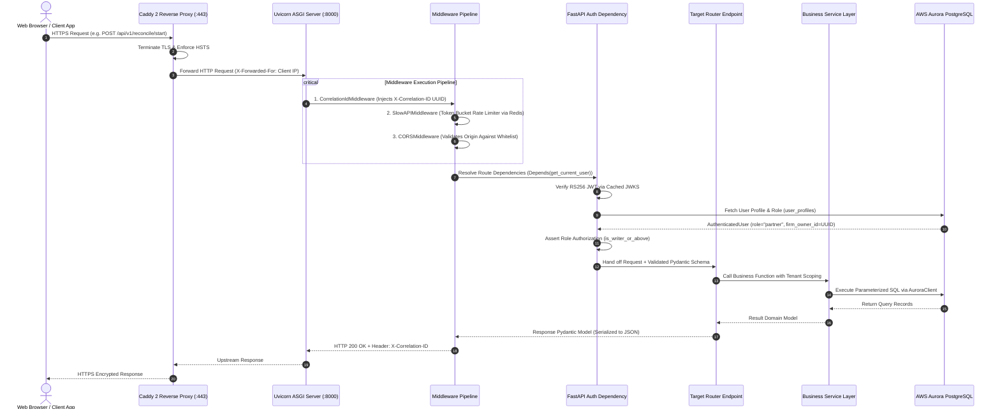
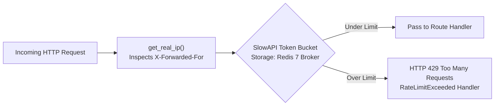

# Volume 09: API Engineering, Routing Architecture & Request Lifecycle

> **Document ID**: `RD-TECH-09`  
> **Author**: Chief Technology Officer & Principal Systems Architect  
> **Target Audience**: ReconDesk Founder, API Architects, Backend Engineers, Security Reviewers, EF / YC Technical Interviewers  
> **Repository Baseline**: `release/v1.5.2-rc1`  
> **Primary Source Evidence**: [`recondesk-backend/app/main.py`](file:///Users/omkarkadam/Documents/ReconDesk/recondesk-backend/app/main.py) (Lines 387–795), [`app/routers/`](file:///Users/omkarkadam/Documents/ReconDesk/recondesk-backend/app/routers/) (59 router files), [`app/auth.py`](file:///Users/omkarkadam/Documents/ReconDesk/recondesk-backend/app/auth.py), [`app/utils/rate_limit.py`](file:///Users/omkarkadam/Documents/ReconDesk/recondesk-backend/app/utils/rate_limit.py), [`app/utils/context.py`](file:///Users/omkarkadam/Documents/ReconDesk/recondesk-backend/app/utils/context.py).

---

## 1. Executive Summary & Web API Architecture

The ReconDesk backend is designed as an asynchronous, high-throughput RESTful API powered by **FastAPI** on an ASGI runtime (**Uvicorn**).

### Core Architectural Invariants:
1. **Zero Global Mutable State**: Every HTTP request is executed within an isolated asynchronous context. Database sessions and authenticated user profiles are injected dynamically via **FastAPI Dependency Injection** (`Depends`), preventing cross-request race conditions.
2. **End-to-End Correlation Tracking**: Every request is assigned a unique `X-Correlation-ID` header at the ASGI boundary, which propagates through application logs, database queries, and external API requests for distributed tracing.
3. **Fail-Closed Security & Strict Rate Limiting**: All sensitive endpoints (authentication, uploads, filing, payment webhooks) enforce token-bucket rate limiting backed by Redis.
4. **Declarative Rust-Accelerated Validation**: All request bodies and response schemas are strictly validated via **Pydantic v2** models, eliminating manual parsing logic and catching malformed payloads before they reach business services.

---

## 2. The Complete Request Lifecycle Architecture



---

## 3. Comprehensive Inventory of the 59 Mounted Routers

All routers are mounted in [`recondesk-backend/app/main.py`](file:///Users/omkarkadam/Documents/ReconDesk/recondesk-backend/app/main.py#L450-L795). They are grouped into 9 functional domains:

| Domain | Mounted Prefix Paths | Router Module | Primary Functionality | Required Auth & Roles |
| :--- | :--- | :--- | :--- | :--- |
| **Authentication & Identity** | `/api/v1/auth`, `/api/auth`, `/auth` | `auth.py`, `cognito_auth.py` | Signup, login, Cognito OAuth callback, password resets | Public & Authenticated |
| **Reconciliation Engine** | `/api/v1/reconciliation`, `/api/reconciliation`, `/api/reconcile` | `reconciliation.py`, `reconciliation_api.py`, `reconciliation_import_wizard.py` | Trigger matching runs, retrieve match results, wizard flow | `is_writer_or_above` |
| **IMS Actions** | `/api/reconcile/ims`, `/api/v1/reconcile/ims` | `ims_actions.py` | Accept, Reject, and Pending action overlays on invoices | `is_writer_or_above` |
| **Client & Practice Management** | `/api/clients`, `/api/v1/clients`, `/api/team`, `/api/practice` | `clients.py`, `team.py`, `practice.py` | Multi-tenant GSTIN management, team invitations, assignments | `is_manager_or_above` |
| **Statutory GST Filing** | `/api/filing`, `/api/gstr1-reconcile`, `/api/einvoice-recon` | `filing.py`, `gstr1_reconcile.py`, `einvoice_recon.py` | GSTR-1 preparation, GSTR-3B suggestions, IRP e-invoicing | `is_admin_or_partner` |
| **Annual & Specialized Returns** | `/api/gstr9`, `/api/gstr9c`, `/api/gstr4`, `/api/gstr1a`, `/api/gstr5`–`11` | `gstr9.py`, `gstr4.py`, `gstr1a.py`, `gstr7.py`, etc. | Annual reconciliation statements, composition, TDS/TCS | `is_writer_or_above` |
| **E-Invoicing & E-Way Bills** | `/api/billing/masters`, `/api/billing/invoices`, `/api/billing/ewaybill` | `billing/masters.py`, `billing/invoices.py`, `billing/ewaybill.py` | Master data, IRN generation, E-Way Bill generation | `is_writer_or_above` |
| **Billing & Payments** | `/api/payments`, `/api/billing`, `/api/coupons` | `payments.py`, `coupons.py`, `admin_coupons.py` | Razorpay order creation, signature verification, coupons | Authenticated & Webhook |
| **Data Ingestion & Reports** | `/api/v1/upload`, `/api/pr-upload`, `/api/v1/reports`, `/api/export` | `upload.py`, `pr_upload.py`, `reports.py`, `export.py` | File uploads, Excel report generation, R2 presigned URLs | `is_writer_or_above` |

---

## 4. Key API Endpoints & Request/Response Contracts

---

### 4.1 Trigger Reconciliation Run
* **HTTP Method**: `POST`
* **Route**: `/api/reconciliation/start`
* **Source Location**: [`reconciliation.py`](file:///Users/omkarkadam/Documents/ReconDesk/recondesk-backend/app/routers/reconciliation.py)
* **Authentication**: Bearer JWT (`get_current_active_user`)
* **Role Requirement**: `is_writer_or_above` (Owner, Partner, Manager, Preparer)

#### Request Schema (Pydantic):
```json
{
  "client_gstin_id": "3fa85f64-5717-4562-b3fc-2c963f66afa6",
  "period": "2024-04",
  "auto_approve_threshold": 95,
  "options": {
    "enable_branch_matching": true,
    "enable_ocr_matching": true,
    "tolerance_pct": 0.01
  }
}
```

#### Response Contract (`HTTP 202 Accepted`):
```json
{
  "run_id": "7b1c4e82-9a3d-4c5f-8b2a-1e9f0d3c5b7a",
  "status": "QUEUED",
  "message": "Reconciliation job dispatched to Celery worker fleet",
  "queue": "reconciliation",
  "created_at": "2026-10-15T18:30:00Z"
}
```

#### Internal Execution Flow:
1. Checks tenant entitlement: Verifies client belongs to `firm_owner_id` and that the firm has remaining credit balance (`runs_balance > 0`).
2. Creates `reconciliation_run` row in Aurora with status `QUEUED`.
3. Calls `celery_app.send_task("worker.execute_reconciliation", args=[run_id], queue="reconciliation")`.
4. Returns `HTTP 202 Accepted` in under **25 milliseconds**.

---

### 4.2 Verify Razorpay Payment Signature
* **HTTP Method**: `POST`
* **Route**: `/api/payments/verify-signature`
* **Source Location**: [`payments.py`](file:///Users/omkarkadam/Documents/ReconDesk/recondesk-backend/app/routers/payments.py#L85-L150)
* **Authentication**: Bearer JWT (`get_current_active_user`)

#### Request Schema (Pydantic):
```json
{
  "razorpay_order_id": "order_N8s9df7Bv6X1",
  "razorpay_payment_id": "pay_N8s9xyz091K2",
  "razorpay_signature": "25a6b0c7d8e9f0123456789abcdef0123456789abcdef0123456789abcdef01"
}
```

#### Signature Verification Logic:
```python
expected = hmac.new(
    settings.RAZORPAY_KEY_SECRET.encode(),
    f"{order_id}|{payment_id}".encode(),
    hashlib.sha256,
).hexdigest()

if not hmac.compare_digest(expected, signature):
    raise HTTPException(status_code=400, detail="Invalid payment signature")
```
* **Security Guard**: Uses `hmac.compare_digest()` to perform **constant-time string comparison**, eliminating timing attack vulnerabilities.

---

### 4.3 Subsystem Health Probe
* **HTTP Method**: `GET`
* **Route**: `/health`
* **Source Location**: [`main.py`](file:///Users/omkarkadam/Documents/ReconDesk/recondesk-backend/app/main.py#L803-L920)
* **Authentication**: Public (Unauthenticated)

#### Response Contract (`HTTP 200 OK`):
```json
{
  "status": "ok",
  "version": "1.0.1",
  "git_commit_sha": "c3b4387be253",
  "uptime_seconds": 84210,
  "supabase": "ok",
  "r2": "ok",
  "aurora": {
    "status": "ok",
    "healthy": true,
    "latency_ms": 4.2,
    "database": "aurora_postgresql"
  },
  "worker": {
    "status": "ok",
    "healthy": true,
    "broker": "redis"
  },
  "environment": "production",
  "timestamp": "2026-10-15T18:32:00Z"
}
```
* **Strict Timeout Invariant**: Each probe is wrapped in `asyncio.wait_for(timeout=2.0s)`. If Aurora or Redis stalls, the probe returns `"status": "degraded"` rather than hanging the reverse proxy into an HTTP 504.

---

## 5. Rate Limiting Architecture (SlowAPI & Redis)

Implemented in [`app/utils/rate_limit.py`](file:///Users/omkarkadam/Documents/ReconDesk/recondesk-backend/app/utils/rate_limit.py):



### Critical Implementation Details:
* **True Client IP Extraction (`get_real_ip`)**:
```python
def get_real_ip(request: Request) -> str:
    forwarded = request.headers.get("X-Forwarded-For")
    if forwarded:
        return forwarded.split(",")[0].strip()
    return request.client.host if request.client else "unknown"
```
Because the application runs behind Caddy and Cloudflare reverse proxies, `request.client.host` would always return the internal Docker IP (`172.18.0.2`). Inspecting the leftmost IP in `X-Forwarded-For` guarantees rate limits apply to the actual client, preventing global throttling of legitimate users.

---

## 6. Global Exception Handling & Error Taxonomy

Implemented in [`main.py`](file:///Users/omkarkadam/Documents/ReconDesk/recondesk-backend/app/main.py#L430-L448):

```python
@app.exception_handler(Exception)
async def unhandled_exception_handler(request: Request, exc: Exception) -> JSONResponse:
    if isinstance(exc, HTTPException):
        return await http_exception_handler(request, exc)
    _log.exception("Unhandled %s %s", request.method, request.url.path)
    if settings.SENTRY_DSN:
        sentry_sdk.capture_exception(exc)

    return JSONResponse(
        status_code=500,
        content={"detail": f"Internal server error: {str(exc) or exc.__class__.__name__}"},
    )
```

### Standard HTTP Status Code Map:
* **HTTP 200 OK**: Request succeeded; data returned.
* **HTTP 202 Accepted**: Asynchronous background task queued (reconciliation, bulk import).
* **HTTP 400 Bad Request**: Malformed parameters or failed signature verification.
* **HTTP 401 Unauthorized**: Missing, expired, or cryptographically invalid Bearer JWT.
* **HTTP 403 Forbidden**: Authenticated user lacks required RBAC role or tenant ownership.
* **HTTP 404 Not Found**: Resource does not exist, or exists under a different `firm_owner_id` (IDOR defense).
* **HTTP 409 Conflict**: Duplicate upload detected via `file_hash` (`uq_run_dedup`).
* **HTTP 422 Unprocessable Entity**: Payload failed Pydantic schema validation.
* **HTTP 429 Too Many Requests**: Rate limit exceeded.
* **HTTP 500 Internal Server Error**: Unhandled exception; captured and scrubbed by Sentry.

---

## 7. API Engineering Interview Questions & Exercises

### 7.1 Founder Self-Testing Questions
1. **Explain the purpose of `CorrelationIdMiddleware`.** How does an `X-Correlation-ID` assist in production incident debugging?
2. **Why does `get_real_ip()` extract the leftmost IP from `X-Forwarded-For`?** What vulnerability occurs if you extract the rightmost IP?
3. **What is the difference between an HTTP 401 and an HTTP 403 status code in ReconDesk?**
4. **How does FastAPI’s dependency injection system prevent race conditions between concurrent requests?**
5. **Why does the `/health` endpoint enforce a 2.0-second timeout on dependency checks?**

### 7.2 Practical Verification Exercises
* **Exercise 1 (Rate Limit Verification)**: Open a terminal and run a curl loop hitting `/api/v1/auth/login` 20 times within 5 seconds. Confirm that the server returns HTTP 429 Too Many Requests with JSON error payload.
* **Exercise 2 (Correlation ID Tracing)**: Run `curl -v http://localhost:8000/health`. Verify that the response headers contain `X-Correlation-ID` with a valid UUIDv4 string.
