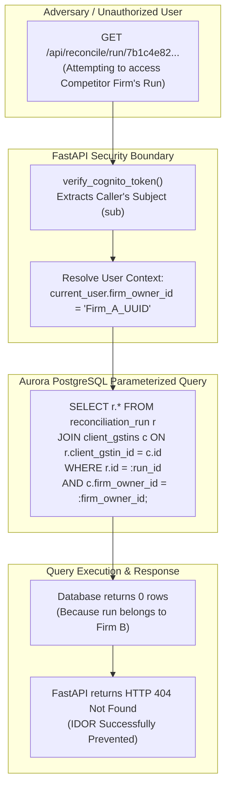

# Volume 12: Security Architecture, Tenant Isolation & OWASP Defenses

> **Document ID**: `RD-TECH-12`  
> **Author**: Chief Technology Officer & Principal Systems Architect  
> **Target Audience**: ReconDesk Founder, Application Security Engineers, Compliance Officers, EF / YC Technical Interviewers  
> **Repository Baseline**: `release/v1.5.2-rc1`  
> **Primary Source Evidence**: [`recondesk-backend/app/auth.py`](file:///Users/omkarkadam/Documents/ReconDesk/recondesk-backend/app/auth.py), [`cognito_verifier.py`](file:///Users/omkarkadam/Documents/ReconDesk/recondesk-backend/app/cognito_verifier.py), [`app/models/roles.py`](file:///Users/omkarkadam/Documents/ReconDesk/recondesk-backend/app/models/roles.py), [`app/models/client_authorizations.py`](file:///Users/omkarkadam/Documents/ReconDesk/recondesk-backend/app/models/client_authorizations.py), [`app/filing/log_safety.py`](file:///Users/omkarkadam/Documents/ReconDesk/recondesk-backend/app/filing/log_safety.py).

---

## 1. Executive Summary & Security Philosophy

In enterprise tax technology, security is a non-negotiable legal requirement. Accounting firms store sensitive commercial invoices, supplier bank details, profit margins, and taxpayer credentials. A single cross-tenant data leak constitutes an immediate breach of client confidentiality under the Institute of Chartered Accountants of India (ICAI) code of ethics and Indian data protection laws (DPDP Act, 2023).

### ReconDesk's Four Security Invariants:
1. **Mathematical Multi-Tenancy Scoping**: Every database read and write is anchored to `firm_owner_id`. No endpoint ever queries `reconciliation_run` or `client_gstins` by entity ID alone.
2. **Fail-Closed Authorization**: If a user’s role, token, or permission is missing or ambiguous, the authorization system defaults to `DEFAULT_FAIL_CLOSED_ROLE = "viewer"`, strictly rejecting write/filing actions.
3. **Cryptographic Integrity & Timing Attack Immunity**: All payment and webhook signatures use constant-time comparison (`hmac.compare_digest`). Tokens are verified using cached RS256 public keys.
4. **Zero-PII Telemetry**: Telemetry sent to external monitoring providers (Sentry) is sanitized through custom scrubbers, masking PANs, GSTINs, and authorization tokens.

---

## 2. Multi-Tenant Data Isolation & IDOR Defense



---

### 2.1 The Insecure Direct Object Reference (IDOR) Danger
In insecure SaaS applications, endpoints query records using only the URL parameter:
```python
# INSECURE CODE EXAMPLE (Vulnerable to IDOR):
@router.get("/runs/{run_id}")
async def get_run(run_id: str, db: Any = Depends(get_db)):
    return db.table("reconciliation_run").select("*").eq("id", run_id).execute()
```
An attacker can simply alter `run_id` in their browser to inspect other accounting firms' financial returns.

### 2.2 The ReconDesk Defense:
In ReconDesk, every query joins the tenant anchor:
```python
# SECURE RECONDESK PATTERN (Verified in repositories/tenancy.py):
query = (
    db.table("reconciliation_run")
    .select("*, client_gstins!inner(firm_owner_id)")
    .eq("id", run_id)
    .eq("client_gstins.firm_owner_id", current_user.firm_owner_id)
    .execute()
)
if not query.data:
    raise HTTPException(status_code=404, detail="Run not found")
```
* **Why HTTP 404 instead of HTTP 403?**: Returning `HTTP 403 Forbidden` confirms to an attacker that the record exists. Returning `HTTP 404 Not Found` reveals zero metadata about competitor records.

---

## 3. Authentication & Cognito RS256 JWKS Verification

* **Source Location**: [`app/cognito_verifier.py`](file:///Users/omkarkadam/Documents/ReconDesk/recondesk-backend/app/cognito_verifier.py) and [`app/auth.py`](file:///Users/omkarkadam/Documents/ReconDesk/recondesk-backend/app/auth.py)

### 3.1 Asymmetric vs Symmetric Tokens:
* **Symmetric Tokens (HS256)**: Use a shared secret key for both signing and verifying. If an attacker extracts the secret key from an application server, they can forge arbitrary tokens.
* **Asymmetric Tokens (RS256)**: Amazon Cognito signs tokens using its **private RSA key**. ReconDesk verifies tokens using Cognito's **public key** published at `/.well-known/jwks.json`. Even if ReconDesk’s web server were compromised, an attacker cannot forge authentication tokens because the private signing key resides exclusively inside AWS.

### 3.2 In-Memory JWKS Caching:
Fetching public keys over the network on every HTTP request adds 100ms of latency and creates an external point of failure. ReconDesk caches the JWKS public key set in memory with an automatic **1-hour TTL (3,600s)** and a **10-second cooldown** to prevent denial-of-service key-refresh floods.

---

## 4. Role-Based Access Control (RBAC) & Maker-Checker

* **Source Location**: [`recondesk-backend/app/models/roles.py`](file:///Users/omkarkadam/Documents/ReconDesk/recondesk-backend/app/models/roles.py) and [`client_authorizations.py`](file:///Users/omkarkadam/Documents/ReconDesk/recondesk-backend/app/models/client_authorizations.py)

### 4.1 Granular Role Hierarchy:
ReconDesk defines 7 distinct practice roles:

```python
class Role(str, Enum):
    OWNER = "owner"          # Firm Principal (Root tenant, billing, delete firm)
    PARTNER = "partner"      # CA Partner (Statutory filing, approval, team admin)
    MANAGER = "manager"      # Practice Manager (Assign clients, review batches)
    PREPARER = "preparer"    # Staff Accountant (Data entry, run matching, draft returns)
    VIEWER = "viewer"        # Client Rep / Read-only User (View dashboard only)
    ADMIN = "admin"          # Legacy alias mapping to OWNER/PARTNER
    STAFF = "staff"          # Legacy alias mapping to PREPARER
```

### 4.2 Fail-Closed Invariant:
If an authenticated user's role is missing from their profile:
```python
DEFAULT_FAIL_CLOSED_ROLE = Role.VIEWER.value
```
The user is downgraded to `viewer`, preventing unprivileged users from initiating write operations.

### 4.3 Maker-Checker Statutory Authorization:
For irreversible actions (such as offsetting tax ledger balances or submitting GSTR-3B filings to the government):
1. **The Maker (Preparer)**: Prepares the reconciliation and drafts the return values.
2. **The Checker (Partner/Owner)**: Receives a cryptographic approval request in [`client_authorizations.py`](file:///Users/omkarkadam/Documents/ReconDesk/recondesk-backend/app/models/client_authorizations.py). The return cannot be transmitted to GSTN until the Partner signs off with their session credentials.

---

## 5. Defense Against the OWASP Top 10

| Vulnerability | Attack Scenario | ReconDesk Implementation Defense | Primary Code Reference |
| :--- | :--- | :--- | :--- |
| **A01: Broken Access Control** | User A tries to view User B's reconciliation | Every query filters by `c.firm_owner_id = current_user.firm_owner_id`. | [`app/services/firm_access.py`](file:///Users/omkarkadam/Documents/ReconDesk/recondesk-backend/app/services/firm_access.py) |
| **A02: Cryptographic Failures** | Eavesdropping on credentials in transit | Caddy 2 enforces TLS 1.3 with 2-year HSTS preload (`max-age=63072000`). | [`Caddyfile`](file:///Users/omkarkadam/Documents/ReconDesk/Caddyfile#L2) |
| **A03: Injection (SQLi)** | Attacker injects `' OR 1=1 --` into invoice number | Parameterized query compilation via SQLAlchemy & `AuroraClient`. Zero string concatenation. | [`app/aurora_client.py`](file:///Users/omkarkadam/Documents/ReconDesk/recondesk-backend/app/aurora_client.py) |
| **A04: Insecure Design** | Staging environment connects to production DB | Two-layer fail-closed Staging Guard halts build and runtime execution. | [`app/staging_guard.py`](file:///Users/omkarkadam/Documents/ReconDesk/recondesk-backend/app/staging_guard.py) |
| **A05: Security Misconfiguration** | Public discovery of internal endpoints | Swagger UI (`/docs`) and ReDoc (`/redoc`) disabled in production (`APP_ENV == "production"`). | [`app/main.py`](file:///Users/omkarkadam/Documents/ReconDesk/recondesk-backend/app/main.py#L393-L394) |
| **A06: Vulnerable Components** | Unpatched dependencies in container | Automated Dependabot alerts, Python 3.11 Debian minimal base image. | [`Dockerfile`](file:///Users/omkarkadam/Documents/ReconDesk/recondesk-backend/Dockerfile) |
| **A07: Identification Failures** | Brute-force credential stuffing | Token-bucket rate limiting via SlowAPI + Redis on `/auth/*` endpoints. | [`app/utils/rate_limit.py`](file:///Users/omkarkadam/Documents/ReconDesk/recondesk-backend/app/utils/rate_limit.py) |
| **A08: Software & Data Integrity** | Corrupted Excel workbook uploaded repeatedly | Ingestion pipeline checks SHA-256 hash (`file_hash`) and `uq_run_dedup`. | [`app/models/reconciliation.py`](file:///Users/omkarkadam/Documents/ReconDesk/recondesk-backend/app/models/reconciliation.py#L163) |
| **A09: Logging & Monitoring** | Customer PANs and passwords leaked to logs | Sentry scrubbers regex-mask PANs, GSTINs, OTPs, and auth headers. | [`app/filing/log_safety.py`](file:///Users/omkarkadam/Documents/ReconDesk/recondesk-backend/app/filing/log_safety.py) |
| **A10: Server-Side Request Forgery** | Attacker manipulates webhooks to hit internal IPs | Razorpay webhook verification restricts endpoints; Sandbox client calls fixed base URL. | [`app/config.py`](file:///Users/omkarkadam/Documents/ReconDesk/recondesk-backend/app/config.py#L170) |

---

## 6. Sentry PII Sanitization & Telemetry Scrubbing

* **Source Location**: [`recondesk-backend/app/filing/log_safety.py`](file:///Users/omkarkadam/Documents/ReconDesk/recondesk-backend/app/filing/log_safety.py)

```python
# Regular expressions for sensitive financial PII
_PAN_REGEX = re.compile(r"\b[A-Z]{5}[0-9]{4}[A-Z]{1}\b")
_GSTIN_REGEX = re.compile(r"\b[0-9]{2}[A-Z]{5}[0-9]{4}[A-Z]{1}[1-9A-Z]{1}Z[0-9A-Z]{1}\b")
_OTP_PARAM_REGEX = re.compile(r"([?&](?:otp|pan|token)=)[^&]+", re.IGNORECASE)

def sentry_scrub_event(event: dict, hint: dict) -> dict | None:
    """Scrub PANs, GSTINs, and OTP query strings before sending to Sentry."""
    url = event.get("request", {}).get("url", "")
    if url:
        event["request"]["url"] = _OTP_PARAM_REGEX.sub(r"\1[REDACTED]", url)
    
    # Recursively scrub exception messages and breadcrumbs
    _scrub_breadcrumbs(event.get("breadcrumbs", {}).get("values", []))
    return event
```
* **Why This Matters**: In tax compliance, logging a taxpayer’s mobile OTP or PAN number in third-party cloud monitoring violates Section 158 of the CGST Act (disclosure of information by a public servant/platform).

---

## 7. Security Interview Questions & Exercises

### 7.1 Founder Self-Testing Questions
1. **Explain what an IDOR vulnerability is and how ReconDesk mathematically prevents it.**
2. **Why does ReconDesk use RS256 asymmetric signing for Cognito tokens instead of symmetric HS256?**
3. **What is the fail-closed role principle in `roles.py`?** What role is assigned if a profile has corrupted data?
4. **How does `hmac.compare_digest()` protect our Razorpay payment verification from timing attacks?**
5. **How do we ensure that Indian taxpayer PII (PAN, GSTIN, OTPs) is never leaked to Sentry?**

### 7.2 Practical Verification Exercises
* **Exercise 1 (IDOR Test Verification)**: Inspect [`recondesk-backend/tests/test_aurora_tenancy.py`](file:///Users/omkarkadam/Documents/ReconDesk/recondesk-backend/tests/test_aurora_tenancy.py). Locate the test asserting that User A cannot access User B's client GSTIN.
* **Exercise 2 (PII Sanitization Test)**: Run `sentry_scrub_event()` against a synthetic URL containing `?otp=123456&pan=ABCDE1234F`. Verify that the output string masks both values.
