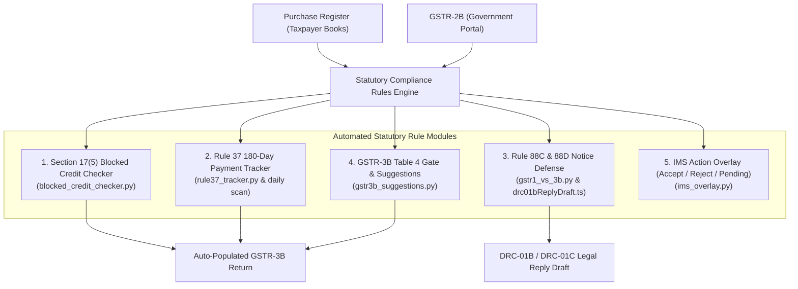
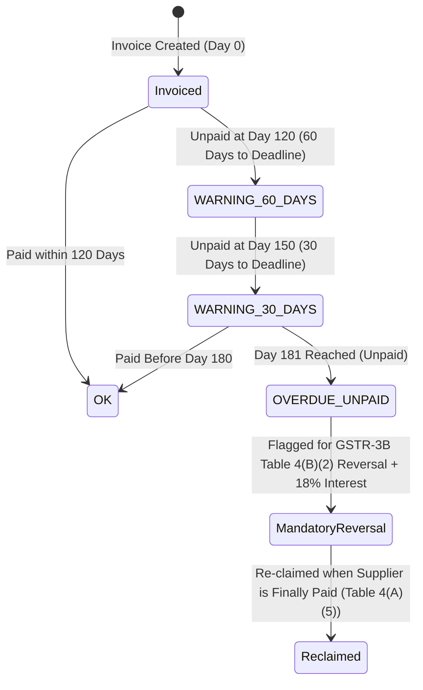

# Volume 13: GST Statutory Compliance Engineering & Rule Engines

> **Document ID**: `RD-TECH-13`  
> **Author**: Chief Technology Officer & Principal Systems Architect  
> **Target Audience**: ReconDesk Founder, Tax Technology Engineers, Chartered Accountants, Due Diligence Auditors  
> **Repository Baseline**: `release/v1.5.2-rc1`  
> **Primary Source Evidence**: [`recondesk-backend/app/services/blocked_credit_checker.py`](file:///Users/omkarkadam/Documents/ReconDesk/recondesk-backend/app/services/blocked_credit_checker.py), [`rule37_tracker.py`](file:///Users/omkarkadam/Documents/ReconDesk/recondesk-backend/app/services/rule37_tracker.py), [`rule37_alert_scan.py`](file:///Users/omkarkadam/Documents/ReconDesk/recondesk-backend/app/services/rule37_alert_scan.py), [`gstr3b_suggestions.py`](file:///Users/omkarkadam/Documents/ReconDesk/recondesk-backend/app/filing/gstr3b_suggestions.py), [`gstr1_vs_3b.py`](file:///Users/omkarkadam/Documents/ReconDesk/recondesk-backend/app/reconciliation/gstr1_vs_3b.py).

---

## 1. Executive Summary: Translating Tax Law into Software Invariants

In financial technology, software bugs in tax calculations are not mere user interface glitches—they carry **strict statutory civil and criminal penalties**. Under Indian GST law:
* Wrongfully claiming Input Tax Credit (ITC) triggers mandatory reversal with **18% annual interest** under Section 50(1) and a **100% penalty** under Section 122(2)(a) for tax evasion.
* Claiming ITC in excess of GSTR-2B triggers automated government tax demand notices under **Rule 88D (Form DRC-01C)**.
* Under-reporting tax liabilities in GSTR-3B compared to GSTR-1 triggers automated demand notices under **Rule 88C (Form DRC-01B)**, leading to automatic blocking of subsequent GSTR-1 filings.

ReconDesk translates these complex, subjective legal statutes into **deterministic, automated software rules**.

---

## 2. Core Statutory Modules in ReconDesk



---

## 3. Section 17(5) Blocked Credit Detection

### 3.1 The Legal Statute
Section 17(5) of the CGST Act, 2017 enumerates specific purchases on which Input Tax Credit is **statutorily blocked**, even if the purchase was made for business purposes:
* **Clause (a)**: Motor vehicles for transportation of persons having approved seating capacity $\le 13$ persons (including driver), vessels, and aircraft.
* **Clause (b)(i)**: Food and beverages, outdoor catering, beauty treatment, health services, cosmetic and plastic surgery.
* **Clause (b)(ii)**: Membership of a club, health, and fitness center.
* **Clause (b)(iii)**: Travel benefits extended to employees on vacation (e.g. Leave Travel Concession).
* **Clause (c) & (d)**: Works contract services or goods supplied for construction of an immovable property (other than plant and machinery).

### 3.2 Technical Implementation via HSN Mapping
Implemented in [`blocked_credit_checker.py`](file:///Users/omkarkadam/Documents/ReconDesk/recondesk-backend/app/services/blocked_credit_checker.py#L23-L80):

```python
BLOCKED_HSN_CODES = {
    "8702": {
        "category": "Motor vehicles for transport of >=10 persons -- Section 17(5)(a)",
        "usage_dependent": True,
        "exempt_note": "Exempt if seating capacity > 13 persons or used for transport business",
    },
    "8703": {
        "category": "Motor vehicles (<13 seater) -- Section 17(5)(a)",
        "usage_dependent": True,
        "exempt_note": "Exempt if used for transport business, driving school, or further supply",
    },
    "8711": {
        "category": "Two-wheelers / Motorcycles -- Section 17(5)(a)",
        "usage_dependent": True,
        "exempt_note": "Exempt if used for commercial delivery or driving school",
    },
    "9963": {
        "category": "Food and beverages, accommodation, catering -- Section 17(5)(b)(i)",
        "usage_dependent": False,
        "exempt_note": "Blocked unless used as inward supply to provide outward catering service",
    },
    "9995": {
        "category": "Club memberships, fitness centers -- Section 17(5)(b)(ii)",
        "usage_dependent": False,
        "exempt_note": "Strictly blocked for all business taxpayers",
    },
    "9997": {
        "category": "Health, beauty, cosmetic surgery -- Section 17(5)(b)(i)",
        "usage_dependent": False,
        "exempt_note": "Strictly blocked unless statutory obligation under law",
    },
}
```

### 3.3 Rule Engine Workflow:
1. When Purchase Register records are parsed, the engine inspects the 4-digit or 6-digit HSN/SAC code.
2. If the code matches `BLOCKED_HSN_CODES`, the invoice is flagged `possible_blocked_credit = True`.
3. In GSTR-3B auto-population, this invoice is **automatically excluded from Table 4(A)(5)** (Eligible ITC) and routed to **Table 4(B)(1)** (ITC Ineligible under Section 17(5)).

---

## 4. Rule 37: 180-Day Supplier Payment & Reversal Tracker

### 4.1 The Legal Mandate
Under the **Second Proviso to Section 16(2)** read with **Rule 37**:
> *If a registered person claims ITC on an inward supply but fails to pay the supplier the invoice value plus tax within **180 days from the invoice date**, the recipient must reverse the claimed ITC in GSTR-3B (Table 4(B)(2)) for the tax period immediately following the 180 days, along with interest at 18% per annum under Section 50(1).*

### 4.2 Software State Machine
Implemented in [`rule37_tracker.py`](file:///Users/omkarkadam/Documents/ReconDesk/recondesk-backend/app/services/rule37_tracker.py#L8-L20):



### 4.3 Automated Daily Supervisor Scan:
In [`main.py`](file:///Users/omkarkadam/Documents/ReconDesk/recondesk-backend/app/main.py#L220-L228), the FastAPI background supervisor runs [`run_rule37_alert_scan()`](file:///Users/omkarkadam/Documents/ReconDesk/recondesk-backend/app/services/rule37_alert_scan.py) daily. It queries all unreversed, unpaid invoices approaching the 180-day deadline, sending high-priority warning emails to the CA to initiate vendor payment before tax penalties accrue.

---

## 5. Automated Notice Defense: Rule 88C (DRC-01B) & Rule 88D (DRC-01C)

### 5.1 Rule 88C (GSTR-1 vs GSTR-3B Liability Mismatch)
* **Trigger**: When output tax liability reported in GSTR-1 exceeds the liability paid in GSTR-3B by more than a specified threshold (typically 10% or ₹25,000), the GST portal issues **Form DRC-01B**.
* **ReconDesk Defense Engine** ([`gstr1_vs_3b.py`](file:///Users/omkarkadam/Documents/ReconDesk/recondesk-backend/app/reconciliation/gstr1_vs_3b.py)): Reconciles outward invoices against GSTR-3B Table 3.1. It generates the statutory mathematical response:
  * Category A: Inward supply mistaken for outward supply.
  * Category B: Unadjusted Credit Notes from previous periods.
  * Category C: Typographical error corrected in subsequent tax periods.

### 5.2 Rule 88D (GSTR-2B vs GSTR-3B ITC Mismatch)
* **Trigger**: When ITC claimed in GSTR-3B exceeds ITC available in GSTR-2B by more than the threshold, the portal issues **Form DRC-01C**.
* **ReconDesk Defense Engine**: Formulates the legal reply draft ([`drc01bReplyDraft.ts`](file:///Users/omkarkadam/Documents/ReconDesk/recondesk-frontend/lib/drc01bReplyDraft.ts)), proving that the excess claim was due to:
  1. Re-credit of previously reversed Rule 37 ITC (statutorily allowed).
  2. Invoices filed late by suppliers in previous tax periods.
  3. Import of goods cleared via ICEGATE.

---

## 6. GSTR-3B Table 4 Gate & Suggestions Engine

Implemented in [`gstr3b_suggestions.py`](file:///Users/omkarkadam/Documents/ReconDesk/recondesk-backend/app/filing/gstr3b_suggestions.py):

| GSTR-3B Table Field | Statutory Description | ReconDesk Ingestion & Matching Mapping |
| :--- | :--- | :--- |
| **Table 4(A)(1)** | Import of Goods | ICEGATE inward entries matched on Bill of Entry (BOE) |
| **Table 4(A)(2)** | Import of Services | RCM inward services with foreign vendor GSTIN |
| **Table 4(A)(3)** | Inward supplies liable to Reverse Charge (RCM) | Invoices flagged `is_rcm = True` via `rcm_detector.py` |
| **Table 4(A)(4)** | Inward supplies from Input Service Distributor (ISD) | GSTR-6 distributor invoices matched from GSTR-2B |
| **Table 4(A)(5)** | All other ITC (Regular B2B Purchases) | Clean Tier L1 & auto-approved L2 matches |
| **Table 4(B)(1)** | Reversal: As per Rules 38, 42, 43 & Section 17(5) | Invoices flagged by `blocked_credit_checker.py` |
| **Table 4(B)(2)** | Reversal: Others (Credit Notes & Rule 37) | Clean Credit Note matches (`CDNR`) + Overdue Rule 37 invoices |
| **Table 4(D)(1)** | Other Details: Reclaimed ITC | Re-claimed supplier invoices previously reversed under Rule 37 |
| **Table 4(D)(2)** | Other Details: Ineligible ITC under Section 16(4) | Invoices dated beyond the September/November annual filing deadline |

### 6.1 The Irreversible Offset Safety Guard:
Offsetting tax liability in GSTR-3B moves **real money** from the client's Electronic Cash/Credit Ledger to the Government. Once offset, it cannot be refunded or undone except via a multi-year formal refund claim.
* **The Guard**: In [`config.py`](file:///Users/omkarkadam/Documents/ReconDesk/recondesk-backend/app/config.py#L271-L280), `gstr3b_filing_enabled` is **hard-coded to False in production by default**. It can only be enabled if explicitly authorized and confirmed via Maker-Checker cryptographic signing.

---

## 7. IMS (Invoice Management System) Integration

In October 2024, the GST Council launched the **Invoice Management System (IMS)**.

### 7.1 How IMS Works:
Before GSTR-2B is generated on the 14th of every month, buyers can view every supplier invoice on the portal and take one of three actions:
1. **Accept**: Confirms the invoice. It flows directly into GSTR-2B as eligible ITC.
2. **Reject**: Rejects the invoice (e.g. wrong GSTIN or fraud). It is completely excluded from GSTR-2B.
3. **Pending**: Defers the invoice (e.g. goods not yet received). It does not flow into current GSTR-2B, remaining available in future tax periods.

### 7.2 ReconDesk IMS Overlay:
Implemented in [`ims_overlay.py`](file:///Users/omkarkadam/Documents/ReconDesk/recondesk-backend/app/services/ims_overlay.py):
* The engine fetches the client’s IMS action ledger.
* If an invoice is marked `PENDING` on IMS, the matcher quarantines the invoice, preventing it from auto-populating into the current month's Table 4(A)(5).

---

## 8. GST Compliance Interview Questions & Exercises

### 8.1 Founder Self-Testing Questions
1. **Why does ReconDesk flag motor vehicle purchases under Section 17(5)?** When is a motor vehicle purchase statutorily eligible for ITC?
2. **Explain the 180-day rule under Rule 37.** What happens if a client pays a supplier on Day 190? Can they re-claim the reversed tax?
3. **What is the difference between Form DRC-01B and Form DRC-01C?** Which rule governs each form?
4. **Why is GSTR-3B tax offset hard-disabled in production by default?** What could happen if an automated script triggered offset without human sign-off?

### 8.2 Practical Verification Exercises
* **Exercise 1 (HSN Blocked Credit Check)**: Call `check_blocked_credits(hsn="8703", amount_paise=1000000)` in a test script. Verify that it returns `possible_blocked_credit = True` with category mentioning Section 17(5)(a).
* **Exercise 2 (Rule 37 Deadline Math)**: Verify lines 8–15 in [`rule37_tracker.py`](file:///Users/omkarkadam/Documents/ReconDesk/recondesk-backend/app/services/rule37_tracker.py). Write a function taking invoice date `2024-01-01` and verifying that the 180-day deadline is correctly calculated as `2024-06-29`.
