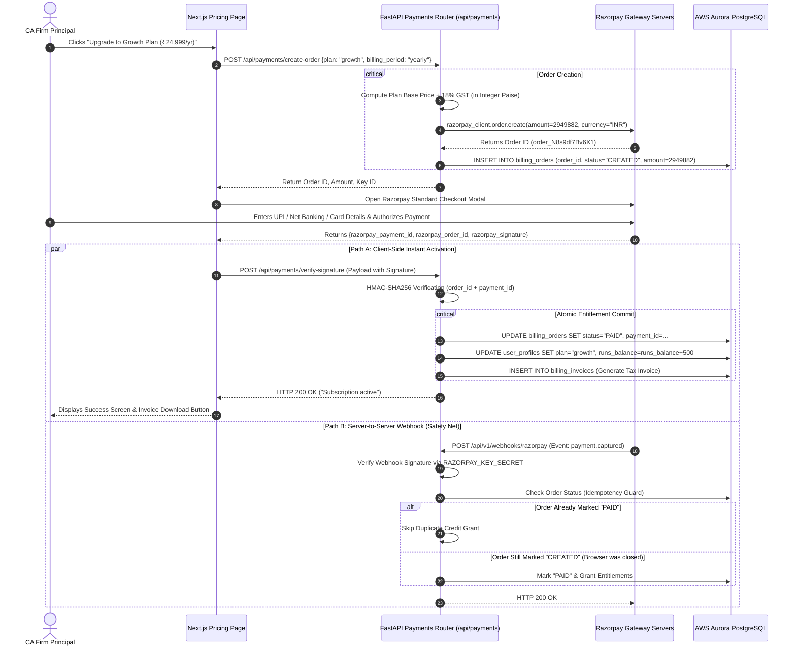

# Volume 14: Payments, Subscriptions & Financial Integrity Architecture

> **Document ID**: `RD-TECH-14`  
> **Author**: Chief Technology Officer & Principal Systems Architect  
> **Target Audience**: ReconDesk Founder, Fintech Engineers, Payment Operations Architects, EF / YC Technical Interviewers  
> **Repository Baseline**: `release/v1.5.2-rc1`  
> **Primary Source Evidence**: [`recondesk-backend/app/routers/payments.py`](file:///Users/omkarkadam/Documents/ReconDesk/recondesk-backend/app/routers/payments.py) (1,156 lines), [`app/services/billing_gate.py`](file:///Users/omkarkadam/Documents/ReconDesk/recondesk-backend/app/services/billing_gate.py), [`app/services/receipt_pdf.py`](file:///Users/omkarkadam/Documents/ReconDesk/recondesk-backend/app/services/receipt_pdf.py), [`app/models/billing.py`](file:///Users/omkarkadam/Documents/ReconDesk/recondesk-backend/app/models/billing.py), [`app/models/coupon.py`](file:///Users/omkarkadam/Documents/ReconDesk/recondesk-backend/app/models/coupon.py).

---

## 1. Executive Summary & Fintech Architecture Invariants

Payment systems in B2B SaaS demand absolute mathematical precision and transactional idempotency. A bug in payment verification can cause:
1. **Unpaid Entitlement Granting (Fraud)**: Malicious users manipulate client-side JavaScript payloads to activate enterprise subscription tiers without paying.
2. **Double-Crediting (Accounting Distortion)**: A customer is credited twice for a single payment due to webhook retry loops.
3. **Lost Purchases (Customer Churn)**: A user's bank account is debited, but a browser crash prevents entitlement activation.
4. **GST Tax Invoice Violations**: Failing to issue a statutory GST tax invoice with the correct SAC code (`998314`) and place-of-supply tax heads (IGST vs CGST/SGST) violates Indian tax law.

ReconDesk resolves these risks through a **dual-confirmation architecture** using **Razorpay**, **HMAC-SHA256 signature verification**, **idempotent database transactions**, and **automated PDF tax invoice generation**.

---

## 2. End-to-End Payment Lifecycle Architecture



---

## 3. Cryptographic Signature Verification & Anti-Tampering

* **Source Location**: [`payments.py`](file:///Users/omkarkadam/Documents/ReconDesk/recondesk-backend/app/routers/payments.py#L62-L68)

### 3.1 The Vulnerability: Client-Side Manipulation
If an application trusts client-side responses (e.g. `if (response.status === "success") { grantSubscription(); }`), an attacker using browser developer tools or HTTP proxies (Burp Suite) can alter the response payload and gain free access.

### 3.2 The Cryptographic Defense:
Razorpay generates an HMAC-SHA256 cryptographic signature using the secret key held only by Razorpay and ReconDesk's backend server:
$$\text{Signature} = \operatorname{HMAC-SHA256}(\text{Order ID} + "|" + \text{Payment ID}, \ \text{RAZORPAY\_KEY\_SECRET})$$

```python
def _verify_webhook(body: bytes, signature: str) -> bool:
    expected = hmac.new(
        settings.RAZORPAY_KEY_SECRET.encode(),
        body,
        hashlib.sha256,
    ).hexdigest()
    return hmac.compare_digest(expected, signature)
```

### 3.3 Defense Against Timing Side-Channel Attacks (`hmac.compare_digest`):
In standard string comparison (`a == b`), the execution halts at the first non-matching character. An attacker measuring network round-trip response times in microseconds can systematically deduce valid cryptographic signatures character by character. 

ReconDesk uses `hmac.compare_digest(expected, signature)`, which executes in **constant time** regardless of where differences occur, completely neutralizing timing attacks.

---

## 4. Idempotency & Webhook Race Condition Safeguards

* **Source Location**: [`app/services/payment_webhook_service.py`](file:///Users/omkarkadam/Documents/ReconDesk/recondesk-backend/app/services/payment_webhook_service.py)

### 4.1 The Race Condition Dilemma:
When a customer pays, two independent network events occur simultaneously:
1. The user's browser sends the payment confirmation to `POST /api/payments/verify-signature`.
2. Razorpay's servers send an HTTP webhook to `POST /api/v1/webhooks/razorpay`.

If both handlers run concurrently without synchronization, the database could increment `runs_balance` twice (granting 1,000 runs instead of 500).

### 4.2 The ReconDesk Solution (Atomic Conditional SQL Update):
Implemented at the database level using atomic state transitions:
```sql
UPDATE billing_orders 
SET status = 'PAID', 
    payment_id = :payment_id, 
    updated_at = NOW() 
WHERE order_id = :order_id 
  AND status = 'CREATED';
```
* **Atomicity Guarantee**: If the client callback reaches the server first, it transitions `status` from `'CREATED'` to `'PAID'` (1 row affected) and grants the credits.
* When the webhook arrives milliseconds later, the query matches 0 rows because `status` is already `'PAID'`. The webhook recognizes the order was already fulfilled and exits safely, logging an idempotent completion event.

---

## 5. Subscription Plan Tiers & Credit Allocation

Defined in [`billing_gate.py`](file:///Users/omkarkadam/Documents/ReconDesk/recondesk-backend/app/services/billing_gate.py#L26-L50):

| Plan Identifier | Public Display Name | Pricing (INR) | Active GSTIN Limit | Included Runs Balance | Over-the-Limit Policy |
| :--- | :--- | :--- | :---: | :---: | :--- |
| `free` | Free Evaluation | ₹0 | 2 GSTINs | 2 Free Runs | Hard stop; requires upgrade |
| `starter` | CA Practice Starter | ₹9,999 / year | 5 GSTINs | 100 Runs | Hard stop; purchase top-up credits |
| `growth` | Multi-Partner Firm | ₹24,999 / year | 15 GSTINs | 500 Runs | Hard stop; purchase top-up credits |
| `enterprise` | Corporate Enterprise | ₹59,999 / year | 50 GSTINs | Unlimited | Custom billing agreement |

### Credit Deduction Workflow (`consume_run_credit`):
When a user triggers a reconciliation run:
1. The engine checks if the firm owner has `runs_balance > 0` or `free_runs_remaining > 0`.
2. Inside an atomic database transaction:
```sql
UPDATE user_profiles 
SET runs_balance = runs_balance - 1, 
    runs_used = runs_used + 1 
WHERE id = :firm_owner_id 
  AND runs_balance > 0;
```
If `runs_balance` is zero, the update affects 0 rows, and the API throws `HTTP 402 Payment Required`, preventing unpaid job execution.

---

## 6. Statutory B2B GST Invoicing for ReconDesk Customers

Under Section 31 of the CGST Act, ReconDesk (as a registered B2B SaaS supplier) must issue a legally compliant tax invoice whenever a customer pays for a subscription.

### 6.1 Statutory Metadata Invariants:
Defined in [`config.py`](file:///Users/omkarkadam/Documents/ReconDesk/recondesk-backend/app/config.py#L181-L189):
* **Seller Legal Name**: `ReconDesk Technologies`
* **Seller Address**: `Hadapsar, Pune, Maharashtra 411028, India`
* **Seller State**: `Maharashtra` (State Code: `27`)
* **SAC Code**: `998314` (Information technology software services)

### 6.2 Place of Supply Tax Head Rules:
Implemented in [`receipt_pdf.py`](file:///Users/omkarkadam/Documents/ReconDesk/recondesk-backend/app/services/receipt_pdf.py#L40-L55):
* **Intra-State Supply (Customer in Maharashtra, State Code `27`)**:
  * CGST @ 9%
  * SGST @ 9%
* **Inter-State Supply (Customer Outside Maharashtra, e.g. Gujarat `24`, Delhi `07`)**:
  * IGST @ 18%

### 6.3 Automated PDF Invoice Synthesis:
Upon payment confirmation, [`receipt_pdf.py`](file:///Users/omkarkadam/Documents/ReconDesk/recondesk-backend/app/services/receipt_pdf.py) utilizes **ReportLab** to generate a signed PDF tax invoice containing:
1. Sequential Invoice Number (e.g. `RD/2024-25/INV-0492`).
2. Customer GSTIN, Legal Name, and Billing Address.
3. Tax breakdown (Taxable Value, CGST, SGST, IGST in integer paise).
4. Permanent storage in Cloudflare R2 with download links available in the customer’s billing dashboard.

---

## 7. Coupon & Discount Engine

Implemented in [`app/models/coupon.py`](file:///Users/omkarkadam/Documents/ReconDesk/recondesk-backend/app/models/coupon.py) and [`app/routers/coupons.py`](file:///Users/omkarkadam/Documents/ReconDesk/recondesk-backend/app/routers/coupons.py):

### Invariants & Validations:
* **`discount_type`**: `percentage` (e.g. 20% off) or `fixed_amount` (e.g. ₹2,000 off).
* **`max_uses` & `uses_count`**: Prevents coupon reuse beyond campaign budgets.
* **`valid_from` & `valid_until`**: Strict time window enforcement using UTC timestamps.
* **`min_order_amount_paise`**: Enforces minimum order size before a discount can apply.
* **Atomic Usage Increment**: Incrementing `uses_count` occurs inside the payment verification transaction, ensuring a coupon is not burned if payment fails.

---

## 8. Payment & Subscription Interview Questions & Exercises

### 8.1 Founder Self-Testing Questions
1. **Trace the exact flow of what happens if a customer pays via UPI, the bank deducts the money, but the customer closes their laptop before returning to the ReconDesk app.** How does the account get activated?
2. **Explain the purpose of `hmac.compare_digest()` in payment signature verification.** Why is standard `==` string comparison insecure?
3. **How does ReconDesk prevent a race condition between the client verification endpoint and the Razorpay webhook?**
4. **Why is the SAC code `998314` used on ReconDesk's customer invoices?** How are CGST, SGST, and IGST calculated?
5. **How does the coupon engine prevent users from exceeding the maximum allowed usage limit during high-concurrency campaigns?**

### 8.2 Practical Verification Exercises
* **Exercise 1 (HMAC Signature Simulation)**: Write a 5-line Python script that computes the HMAC-SHA256 signature for order ID `order_123` and payment ID `pay_456` using test secret `secret_789`. Verify it against `_verify_webhook()`.
* **Exercise 2 (Tax Head Calculation)**: Write a Python function taking customer state code `27` and calculating tax heads for a ₹10,000 base plan. Verify that it allocates ₹900 CGST and ₹900 SGST instead of ₹1,800 IGST.
