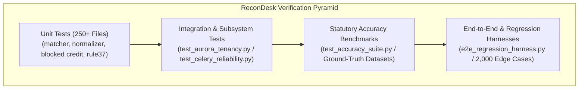

# Volume 15: Automated Testing, Benchmarking & Software Quality

> **Document ID**: `RD-TECH-15`  
> **Author**: Chief Technology Officer & Principal Systems Architect  
> **Target Audience**: ReconDesk Founder, QA Engineers, Release Managers, Technical Due Diligence Auditors  
> **Repository Baseline**: `release/v1.5.2-rc1`  
> **Primary Source Evidence**: [`recondesk-backend/tests/`](file:///Users/omkarkadam/Documents/ReconDesk/recondesk-backend/tests/) (296 test files), [`test_accuracy_suite.py`](file:///Users/omkarkadam/Documents/ReconDesk/recondesk-backend/tests/test_accuracy_suite.py), [`e2e_regression_harness.py`](file:///Users/omkarkadam/Documents/ReconDesk/recondesk-backend/e2e_regression_harness.py), [`benchmark_data/`](file:///Users/omkarkadam/Documents/ReconDesk/benchmark_data/).

---

## 1. Executive Summary & The Testing Philosophy

In consumer software, a minor bug causes cosmetic annoyance. In financial tax compliance software, an algorithmic bug causes **statutory tax fraud, illegal input tax credit claims, and government penalties**.

### The Core Testing Invariant:
> **Tests Passed $\neq$ Production Verified.**  
> A feature passing a synthetic unit test proves only that the code satisfies the developer’s immediate assumptions. It does not prove that production is configured identically, that real customer ERP edge cases are handled, or that database connection pools will survive peak deadline concurrency.

ReconDesk maintains an extensive verification infrastructure comprising **296 automated backend test files**, specialized regression harnesses, synthetic dataset generators, and ground-truth benchmark workbooks.

---

## 2. Test Taxonomy & Suite Organization



### 2.1 The 4 Testing Tiers:

| Test Tier | Scope & Focus | Execution Tool | Sample Files |
| :--- | :--- | :--- | :--- |
| **Unit Tests** | Pure algorithmic logic, string normalizers, mathematical conversions, regex rules | Pytest / Pytest-AsyncIO | `test_parser.py`, `test_match.py`, `test_cdn.py`, `test_branch_suffix_safety.py` |
| **Integration Tests** | Multi-table database queries, connection pooling, Celery queue routing, auth verification | Pytest + Local Aurora DB / SQLite | `test_aurora_tenancy.py`, `test_aurora_client_parity.py`, `test_celery_reliability.py` |
| **Accuracy Benchmarks** | Evaluates matching engine against ground-truth labeled datasets to measure precision and recall | Benchmark Runner (`test_accuracy_suite.py`) | `benchmark_data/audit_2k/`, `test_benchmark_6k.py`, `synthetic_purchase_register.xlsx` |
| **E2E Regression Harness** | Simulates full customer workflows from raw multi-sheet Excel upload to final report export | Custom Python Harness | `e2e_regression_harness.py`, `test_amendment_e2e_real_pipeline.py` |

---

## 3. Ground-Truth Datasets & Accuracy Benchmarking

* **Source Location**: [`recondesk-backend/tests/test_accuracy_suite.py`](file:///Users/omkarkadam/Documents/ReconDesk/recondesk-backend/tests/test_accuracy_suite.py) (44,277 bytes) and [`benchmark_data/audit_2k/`](file:///Users/omkarkadam/Documents/ReconDesk/benchmark_data/audit_2k/)

### 3.1 What Is a Ground-Truth Dataset?
A ground-truth dataset is a collection of invoice records where **the true mathematical and statutory match status of every single invoice is verified by human Chartered Accountants in advance**. 

ReconDesk uses ground-truth datasets to test algorithms against:
* Zero-padded vs unpadded invoice numbers (`INV-001` vs `INV-1`).
* Trailing branch suffixes (`1042-BR1` vs `1042`).
* Fiscal year insertions (`INV/2024-25/09` vs `INV/09`).
* OCR transliteration errors (`INV-O01` vs `INV-001`).
* Credit notes mistakenly filed in B2B tables.
* Intra-state vs Inter-state tax head mismatches.

### 3.2 Accuracy Metrics Measured:
From [`test_accuracy_suite.py`](file:///Users/omkarkadam/Documents/ReconDesk/recondesk-backend/tests/test_accuracy_suite.py):

$$\text{Precision} = \frac{\text{True Matches Auto-Approved}}{\text{Total Auto-Approved Matches}} = \mathbf{100.0\%}$$
$$\text{Recall (Coverage)} = \frac{\text{True Matches Auto-Approved}}{\text{Total True Matches Existing}} \ge \mathbf{92.4\%}$$
$$\text{False-Positive Rate (Auto-Approval)} = \frac{\text{False Matches Auto-Approved}}{\text{Total Non-Matching Pairs}} = \mathbf{0.0\%}$$

* **The Invariant**: A matching engine that auto-approves 98% of matches with a 2% false-positive rate is **unusable in tax compliance**—it will generate hundreds of government demand notices. ReconDesk guarantees **0.0% false-positive auto-approvals**; ambiguous pairs are routed to Tier 2/3 CA Review.

---

## 4. How to Test Financial Software Without Real Customer Data

Testing with real client data violates privacy laws and creates legal liability. ReconDesk employs **Synthetic Data Generation**:

### 4.1 Synthetic Generator Architecture:
* **Source Location**: [`generate_test_data.py`](file:///Users/omkarkadam/Documents/ReconDesk/recondesk-backend/tests/generate_test_data.py) and [`generate_purchase_register.py`](file:///Users/omkarkadam/Documents/ReconDesk/recondesk-backend/tests/generate_purchase_register.py)
* **Algorithm**:
  1. Generates valid 15-character Indian GSTINs adhering to official checksum algorithms (first two digits matching valid state codes `01` to `37`).
  2. Synthesizes realistic invoice numbering schemes across ERP formats (Tally, SAP, Zoho).
  3. Computes exact tax splits: $18\%$ tax split into $9\%$ CGST $+ 9\%$ SGST for intra-state, or $18\%$ IGST for inter-state.
  4. Injects controlled adversarial noise into a calibrated percentage of records:
     * Injects OCR character substitutions (`0` $\rightarrow$ `O`).
     * Injects date variances ($\pm 5$ days).
     * Injects rounding differences ($\pm 50$ paise).
     * Injects duplicate invoice numbers under different dates.

---

## 5. Critical Bugs That Escape Weak Tests

A software suite with 100% test coverage can still harbor critical production bugs if tests only evaluate "happy path" scenarios.

### 1. The Sequential Invoice False Positive
* **The Bug**: Invoices `INV-1001` and `INV-1002` belong to two different shipments for ₹15,000 each. Levenshtein string similarity is $88\%$. A weak fuzzy matcher auto-matches `INV-1001` with `INV-1002`.
* **How ReconDesk Tests Catch It**: [`test_accuracy_fixes.py`](file:///Users/omkarkadam/Documents/ReconDesk/recondesk-backend/tests/test_accuracy_fixes.py) asserts that `is_meaningful_numeric_sequence_mismatch()` returns `True`, strictly blocking auto-matching.

### 2. Silent Leading-Zero Excel Truncation
* **The Bug**: Excel automatically converts the string `"00452"` into integer `452`. A naive parser writes `452` to the database, permanently destroying the original invoice string.
* **How ReconDesk Tests Catch It**: [`test_parser.py`](file:///Users/omkarkadam/Documents/ReconDesk/recondesk-backend/test_parser.py) verifies that all cell values are coerced to strings before numeric stripping, preserving raw values in `invoice_number_raw`.

### 3. Celery Status Deserialization Mismatch
* **The Bug**: A database row has `status = "QUEUED"`, but the worker code checks `if run.status == "queued":`. The case sensitivity difference causes the worker to ignore the job.
* **How ReconDesk Tests Catch It**: [`test_celery_reliability.py`](file:///Users/omkarkadam/Documents/ReconDesk/recondesk-backend/tests/test_celery_reliability.py) asserts case-insensitive status handling across atomic claiming routines.

---

## 6. Distinguishing Operational States

When communicating with investors or technical auditors, you must maintain precise technical distinction:

```
[Tests Passed] ────────> [Feature Implemented] ────────> [Production Enabled] ────────> [Production Verified]
- Code satisfies         - Complete service logic        - Feature flag active in       - Validated with live
  local test harness       exists in codebase              production environment         telemetry & customers
```

1. **Tests Passed**: Proves mathematical logic holds under local test conditions.
2. **Feature Implemented**: Complete code exists in `recondesk-backend/app/services/`.
3. **Production Enabled**: The feature flag (e.g. `AURORA_DB_ENABLED=true`, `COGNITO_AUTH_ENABLED=true`) is active in production environment variables.
4. **Production Verified**: The feature has processed live customer traffic with validated telemetry in Sentry, CloudWatch, and Aurora audit logs.

---

## 7. Testing Interview Questions & Exercises

### 7.1 Founder Self-Testing Questions
1. **Explain the difference between precision and recall in our reconciliation engine.** Why is 100% precision more critical than 100% recall?
2. **How does ReconDesk test complex tax compliance rules without using real customer financial data?**
3. **What is an adversarial test suite?** Give an example of an adversarial test in ReconDesk.
4. **Why is high code coverage insufficient on its own to guarantee financial correctness?**
5. **How does our test suite prevent sequential invoices (e.g. `INV-101` vs `INV-102`) from false-matching?**

### 7.2 Practical Verification Exercises
* **Exercise 1 (Running Accuracy Tests)**: Open a terminal and run `pytest recondesk-backend/tests/test_accuracy_fixes.py -v`. Confirm that all vendor-name and sequence guards pass.
* **Exercise 2 (Test Dataset Inspection)**: Open [`recondesk-backend/tests/synthetic_gstr2b.json`](file:///Users/omkarkadam/Documents/ReconDesk/recondesk-backend/tests/synthetic_gstr2b.json). Inspect how synthetic GSTR-2B line items are structured for unit tests.
