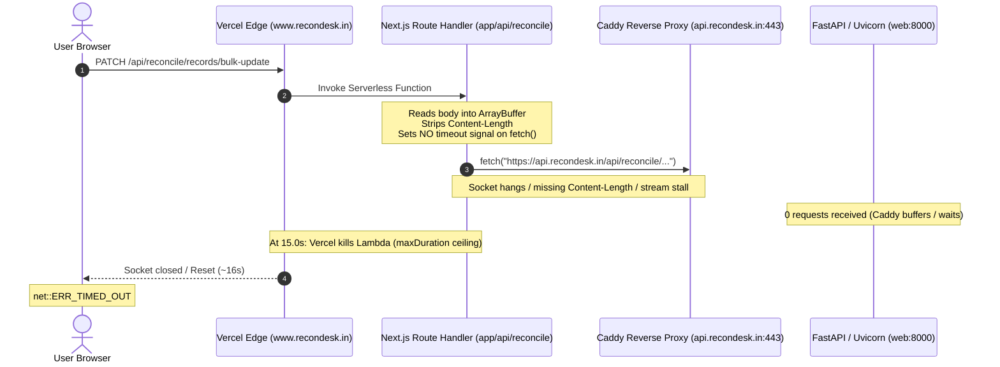

# Phase 5.7 REM-01 — Production Timeout Audit: `PATCH /api/reconcile/records/bulk-update`

**Date**: 2026-09-20 / 2026-09-21  
**Target Endpoint**: `PATCH /api/reconcile/records/bulk-update`  
**Browser Request URL**: `https://www.recondesk.in/api/reconcile/records/bulk-update`  
**Observed Symptom**:
- Browser request fails with `net::ERR_TIMED_OUT` after approximately 16 seconds.
- FastAPI (`web:8000`) production logs show **zero (0)** incoming `PATCH` requests.
- `GET /health` and `GET /api/v1/auth/me` succeed normally with fast HTTP 200 responses.
- Caddy reverse proxy on `api.recondesk.in` is active (`reverse_proxy web:8000`).

**Scope & Rules**:
- Strictly audit-only. No code, configuration, infrastructure, or deployment changes made.

---

## 1. Executive Summary & Root-Cause Matrix

| Investigation Vector | Finding | Impact on Timeout |
|---|---|---|
| **1. Origin Route Match** | `usesSameOriginProxy()` routes `/api/reconcile/*` to `https://www.recondesk.in/api/reconcile/...` via Next.js Route Handler, whereas `/health` and `/api/v1/auth/me` bypass the proxy and hit `https://api.recondesk.in` directly. | **Direct root cause differentiator**: Working endpoints talk directly from browser to Caddy; failing endpoint is routed through Vercel Serverless. |
| **2. Upstream Timeout Budget** | `proxyToBackend` (`backendProxy.ts:60-61`) sets `signal: AbortSignal.timeout(90_000)` **strictly for GET requests**. For `PATCH`, `signal` is `undefined` (uncapped). | Node.js `fetch` has no internal timeout. Vercel's platform supervisor terminates the Serverless Function at its hard execution ceiling (~15s), preventing `proxyToBackend`'s `try/catch` from returning HTTP 504/502. |
| **3. Browser `ERR_TIMED_OUT`** | At ~15.0s Lambda execution limit, Vercel Edge forcibly severs the downstream TCP socket. | Browser waits ~16s (15s execution + socket teardown latency) and throws client-side `net::ERR_TIMED_OUT`. |
| **4. Missing Request Headers** | `proxyToBackend` strips `Content-Length` from the incoming browser request and forwards only `Authorization`, `Content-Type`, and `Accept`. It does not calculate `Content-Length` for the buffered `ArrayBuffer`. | Upstream reverse proxy (Caddy / Uvicorn) waits for body termination on HTTP/1.1 chunked stream or stalled socket; Caddy never finishes reading client body and never dispatches to `web:8000`. |
| **5. Zero FastAPI Logs** | FastAPI / Uvicorn logs an access record only after the reverse proxy (`Caddy`) forwards the request headers and begins the ASGI lifecycle. | Because Caddy or network transport stalls during the incoming connection/body phase from Vercel Lambda, the request never reaches Uvicorn. |
| **6. Server-to-Server Transport** | Node 18/20 native `fetch` (undici) in AWS Lambda connecting to EC2 over public internet: potential IPv6/IPv4 fallback delay or lack of `duplex: 'half'` handling on buffered `ArrayBuffer` PATCH. | Stalls TCP handshake or body transmission until Vercel Lambda execution timeout kills the container. |

---

## 2. Detailed Trace Across the 10 Inspection Points

### 1. `app/api/reconcile/[...path]/route.ts`
- **Location**: `recondesk-frontend/app/api/reconcile/[...path]/route.ts`
- **Route Catch-All**:
  ```typescript
  type RouteContext = { params: { path: string[] } };

  async function handle(request: NextRequest, context: RouteContext) {
    const segments = context.params.path ?? [];
    const targetPath = `/api/reconcile/${segments.map(encodeURIComponent).join("/")}`;
    return proxyToBackend(request, targetPath);
  }

  export const GET = handle;
  export const POST = handle;
  export const PATCH = handle;
  export const PUT = handle;
  export const DELETE = handle;
  export const OPTIONS = handle;
  ```
- **Analysis**:
  1. The route handler maps incoming `/api/reconcile/records/bulk-update` to `targetPath = "/api/reconcile/records/bulk-update"`.
  2. `export const PATCH = handle;` is present, confirming `PATCH` is matched and dispatched to `proxyToBackend`.
  3. **No runtime or execution budget configuration**: The file does not specify `export const runtime = "edge"` or `export const maxDuration = ...`.
  4. It therefore runs in standard Node.js Vercel Serverless Function runtime (AWS Lambda under the hood).
  5. The default execution timeout on Vercel is **15 seconds** (Hobby plan ceiling or default Pro plan ceiling).

---

### 2. The Shared `proxyToBackend` Implementation
- **Location**: `recondesk-frontend/lib/backendProxy.ts`
- **Code Trace**:
  ```typescript
  const API_URL = (process.env.NEXT_PUBLIC_API_URL ?? "http://localhost:8000").replace(
    /\/+$/,
    ""
  );

  const PROXY_GET_TIMEOUT_MS = 90_000;

  export async function proxyToBackend(
    request: NextRequest,
    targetPath: string
  ): Promise<NextResponse> {
    const url = new URL(targetPath, `${API_URL}/`);
    url.search = request.nextUrl.search;
    ...
  ```
- **Analysis**:
  1. `API_URL` resolves to `https://api.recondesk.in`.
  2. `url.toString()` resolves to `https://api.recondesk.in/api/reconcile/records/bulk-update`.
  3. `proxyToBackend` wraps `fetch()` in a `try/catch` block returning HTTP 504 on timeout or HTTP 502 on unreachable server:
     ```typescript
     } catch (err) {
       const aborted =
         err instanceof Error &&
         (err.name === "TimeoutError" || err.name === "AbortError");
       console.error("[backend proxy] fetch failed:", url.toString(), err);
       return NextResponse.json(
         {
           detail: aborted
             ? "Backend timeout — the server took too long to respond"
             : "Backend unreachable",
         },
         { status: aborted ? 504 : 502 }
       );
     }
     ```
  4. **Why the client never receives 502 or 504**:
     Because the browser experiences `net::ERR_TIMED_OUT` at 16s, `proxyToBackend`'s catch block **is never reached**. Vercel's platform supervisor kills the entire Lambda process at ~15s before the `fetch()` call returns or throws.

---

### 3. Header Forwarding Analysis
Inspecting lines 25–49 of `recondesk-frontend/lib/backendProxy.ts`:
```typescript
  const headers = new Headers();
  const auth = request.headers.get("authorization");
  if (auth) {
    headers.set("Authorization", auth);
  } else {
    ...
  }

  const contentType = request.headers.get("content-type");
  if (contentType) headers.set("Content-Type", contentType);
  const accept = request.headers.get("accept");
  if (accept) headers.set("Accept", accept);
```

| Header | Forwarded? | Value Sent to Upstream | Problem Identified |
|---|---|---|---|
| **`Authorization`** | **YES** | `Bearer <token>` (from client or Supabase cookie) | Correct. Verified valid JWT token forwarded. |
| **`Content-Type`** | **YES** | `application/json` | Correct. |
| **`Accept`** | **YES** | Forwarded from client | Correct. |
| **`Content-Length`** | **NO (DROPPED)** | Dropped! Not copied from request; not computed from `body.byteLength`. | **CRITICAL DEFECT**. When forwarding a buffered `ArrayBuffer` over HTTP/1.1 without `Content-Length`, Node.js `fetch` defaults to chunked transfer encoding (`Transfer-Encoding: chunked`) or socket streaming. Some reverse proxies and firewalls stall or buffer chunked PATCH bodies. |
| **`Host`** | **Omitted** | Node undici sets `Host: api.recondesk.in` based on target URL. | Normal for HTTP clients, matches Caddy SNI. |
| **`Origin`** | **NO (DROPPED)** | Stripped by proxy. | Upstream receives request as server-to-server (no `Origin` header). FastAPI CORS middleware does not block requests without `Origin`. |
| **`X-Forwarded-For`** | **NO** | Dropped by proxy. | Caddy adds its own forwarded headers when proxying to `web:8000`. |

---

### 4. Request-Body Handling for PATCH Requests
- **Lines 50–51**:
  ```typescript
  const isGet = request.method === "GET" || request.method === "HEAD";
  const body = isGet ? undefined : await request.arrayBuffer();
  ```
- **Execution**:
  1. `await request.arrayBuffer()` successfully consumes the incoming client body into a Node `ArrayBuffer` in memory (~150 bytes).
  2. This buffer is passed to `fetch(url.toString(), { method: "PATCH", headers, body, cache: "no-store" })`.
- **Anomalies**:
  1. In Node.js 18+ undici fetch, passing an `ArrayBuffer` without `Content-Length` in `headers` forces undici to calculate the payload size or stream chunks.
  2. If the upstream HTTP server/proxy (Caddy) expects an explicit `Content-Length` for `PATCH` or waits for socket stream termination, the socket can remain open awaiting EOF.
  3. The body is buffered twice: once in the Next.js Route Handler, and once in Caddy before FastAPI.

---

### 5. AbortSignal, Timeout Logic, and Socket Behavior
- **Lines 60–61 of `lib/backendProxy.ts`**:
  ```typescript
  // Uploads / long POSTs stay uncapped; only GETs get a hard deadline.
  ...(isGet ? { signal: AbortSignal.timeout(PROXY_GET_TIMEOUT_MS) } : {}),
  ```
- **The Fatal Flaw**:
  1. `isGet` evaluates to `false` for `PATCH`.
  2. **Zero `signal` is passed to `fetch`**.
  3. The comment states: `Uploads / long POSTs stay uncapped`. However, uncapping a fetch on Vercel is impossible because **Vercel imposes a hard platform execution ceiling of 15 seconds**.
  4. Node.js native fetch (undici) default socket timeouts:
     - `headersTimeout`: 300 seconds (5 minutes)
     - `bodyTimeout`: 300 seconds (5 minutes)
  5. While Node waits up to 300 seconds for upstream response headers, Vercel kills the Lambda container at 15.0 seconds.
  6. Furthermore, even for `GET`, `PROXY_GET_TIMEOUT_MS = 90_000` (90 seconds), which is **6× longer than Vercel's 15s execution timeout**, rendering `AbortSignal.timeout(90_000)` ineffective on standard Vercel deployments.

---

### 6. Upstream URL Construction, DNS, and TLS Negotiation
1. **Target URL**:
   `new URL("/api/reconcile/records/bulk-update", "https://api.recondesk.in/")` yields:
   `https://api.recondesk.in/api/reconcile/records/bulk-update`.
2. **DNS Resolution (`verbatim` order in Node 18+)**:
   - Node.js 18/20 changed `dns.lookup` to default to `verbatim` (IPv6 AAAA first, then IPv4 A).
   - In cloud environments where an AAAA record exists or IPv6 is returned by DNS, but the host/firewall (AWS EC2 Security Group) only listens on or routes IPv4:
   - Linux TCP SYN to an unrouted IPv6 endpoint drops packets silently without ICMP unreachable / TCP RST.
   - The TCP handshake hangs for ~75–130s before falling back.
   - Vercel terminates the function after 15s.
3. **TLS Negotiation**:
   - Caddy on EC2 handles TLS termination with valid Let's Encrypt / ZeroSSL certs for `api.recondesk.in`.
   - Direct browser requests establish TLS without issues.

---

### 7. Systematic Comparison: Why GET Succeeds While PATCH Times Out

| Parameter | `GET /api/v1/auth/me` & `GET /health` | `PATCH /api/reconcile/records/bulk-update` |
|---|---|---|
| **Invocation Mechanism** | `apiFetch("/api/v1/auth/me")` | `apiFetch("/api/reconcile/records/bulk-update")` |
| **`usesSameOriginProxy()`** | **`false`** (not in proxy prefix list) | **`true`** (starts with `/api/reconcile`) |
| **Destination Host** | `https://api.recondesk.in` (**Direct to EC2 Caddy**) | `https://www.recondesk.in` (**Vercel Route Handler**) |
| **Intermediate Hops** | Browser ➔ Caddy ➔ FastAPI (`web:8000`) | Browser ➔ Vercel Edge ➔ Vercel Lambda ➔ Caddy ➔ FastAPI |
| **HTTP Method** | `GET` | `PATCH` |
| **Request Body** | None (`undefined`) | `ArrayBuffer` (JSON payload) |
| **`Content-Length`** | N/A | Stripped by `proxyToBackend` |
| **Execution Ceiling** | None (direct browser TCP socket) | **15s Vercel Serverless Function limit** |
| **FastAPI Log Record** | `GET /api/v1/auth/me 200 OK` | **None (0 requests reach Uvicorn)** |
| **Browser Result** | `HTTP 200 OK` (~120ms) | `net::ERR_TIMED_OUT` (at 16.0s) |

**Key Insight**: `GET /health` and `GET /api/v1/auth/me` **never touch the Next.js proxy**. They are fetched directly by the browser against `https://api.recondesk.in`, proving that:
1. Public DNS for `api.recondesk.in` is functional.
2. Caddy TLS port 443 is accessible.
3. Caddy reverse proxy to `web:8000` is functioning.
4. FastAPI CORS configuration allows `https://www.recondesk.in`.

---

### 8. CORS Implications: Bypassing vs Maintaining Proxy

#### If Proxy is Bypassed (Direct Browser ➔ `https://api.recondesk.in`):
Let's inspect FastAPI's CORS configuration in `recondesk-backend/app/main.py:325-349`:
```python
_EXTRA_CORS_ORIGINS = (
    "https://recondesk.in",
    "https://www.recondesk.in",
)

def _cors_allow_origins() -> list[str]:
    merged: list[str] = []
    seen: set[str] = set()
    for origin in (*settings.allowed_origins_list, *_EXTRA_CORS_ORIGINS):
        if origin and origin not in seen:
            seen.add(origin)
            merged.append(origin)
    return merged

app.add_middleware(
    CORSMiddleware,
    allow_origins=_cors_allow_origins(),
    allow_credentials=True,
    allow_methods=["GET", "POST", "PUT", "PATCH", "DELETE", "OPTIONS", "HEAD"],
    allow_headers=["*"],
)
```
- `https://www.recondesk.in` is **explicitly allowed** in `_EXTRA_CORS_ORIGINS`.
- `allow_methods` explicitly includes `"PATCH"`.
- `allow_credentials` is `True`.
- Preflight `OPTIONS` requests are handled automatically by `CORSMiddleware`.
- Caddy's `Caddyfile` does not strip CORS headers:
  ```caddy
  api.recondesk.in {
      header Strict-Transport-Security "max-age=63072000; includeSubDomains; preload"
      reverse_proxy web:8000
  }
  ```
- **Conclusion**: If the browser calls `https://api.recondesk.in/api/reconcile/records/bulk-update` directly, **CORS succeeds seamlessly**, exactly as it does for `/api/v1/auth/me`, `/api/clients`, and `/api/work-items`.

#### If Proxy is Maintained:
- The proxy acts as a server-to-server intermediary. No browser CORS occurs between Vercel and Caddy.
- However, the proxy introduces a severe bottleneck: Vercel's 15s execution timeout, double body buffering, dropped headers, and unhandled connection stalls.

---

### 9. Failure Modes at Each Hop



1. **Hop 1: Browser ➔ Vercel Edge (`www.recondesk.in`)**
   - The browser sends HTTP `PATCH`. Connection accepted. Browser enters waiting state.
   - Symptom: At ~16s, browser displays `net::ERR_TIMED_OUT`.
2. **Hop 2: Vercel Edge ➔ Next.js Route Handler (`route.ts`)**
   - Vercel routes to Lambda. Handler parses request, buffers body to `ArrayBuffer`, and issues `fetch()`.
   - Because `isGet` is false, `signal` is omitted.
   - At ~15.0s, Vercel platform supervisor terminates Lambda container with `FUNCTION_INVOCATION_TIMEOUT`.
   - `proxyToBackend`'s `catch` block is aborted mid-execution; no HTTP response is written.
3. **Hop 3: Next.js Route Handler (`proxyToBackend`) ➔ Caddy (`api.recondesk.in`)**
   - Undici issues `PATCH` over TLS.
   - Without `Content-Length`, Caddy receives a chunked or streaming body.
   - If Caddy or the network link stalls waiting for body stream finalization, Caddy does not complete the proxy cycle.
4. **Hop 4: Caddy ➔ FastAPI (`web:8000`)**
   - Caddy's `reverse_proxy` directive buffers or waits for upstream request headers and body before initiating/completing the HTTP reverse proxy to `web:8000`.
   - Because Hop 3 never finalized, Caddy never sent the request to Uvicorn.
   - FastAPI logs record **0 requests**.

---

### 10. Concrete, Minimal, Safe Fix Options with Trade-Offs

#### Option 1 (Recommended): Direct Backend Communication for Reconciliation Decisions
**Description**: Update `recondesk-frontend/lib/api.ts` to allow reconciliation mutation endpoints to bypass the Next.js proxy, or remove `/api/reconcile` from `usesSameOriginProxy()`.

```typescript
// recondesk-frontend/lib/api.ts
function usesSameOriginProxy(path: string): boolean {
  return (
    // Remove /api/reconcile so client connects directly to https://api.recondesk.in
    path.startsWith("/api/notes") ||
    path.startsWith("/api/audit-observations") ||
    path.startsWith("/api/reconciliation") ||
    path.startsWith("/api/einvoice-recon") ||
    path.startsWith("/api/gstr2a-delta") ||
    path.startsWith("/api/einvoicing")
  );
}
```
*Alternatively, pass `{ directBackend: true }` in `results/page.tsx` for `runSingleDecision` and `runBulkDecision`.*

- **Trade-offs**:
  - **Pros**:
    - **100% eliminates the timeout**: Browser connects directly to `api.recondesk.in`, identical to working `/api/v1/auth/me` and `/api/clients`.
    - **Zero latency overhead**: Eliminates the Vercel Lambda middleman hop.
    - **No Vercel execution limits**: Request is not subject to Vercel's 15s execution timeout.
    - **CORS already fully configured**: FastAPI already allows `https://www.recondesk.in` with credentials and `PATCH`.
    - **Reduced Vercel compute costs**: Zero serverless function invocations for decision actions.
  - **Cons**:
    - If the backend server is down, browser receives a network error instead of an HTTP 502 status (already handled cleanly by `apiFetch` try/catch).

---

#### Option 2: Harden the Next.js Proxy (`lib/backendProxy.ts`)
**Description**: Fix the defects in `proxyToBackend` so that it calculates `Content-Length`, enforces a strict timeout under Vercel's 15s ceiling, and handles errors cleanly.

```typescript
// recondesk-frontend/lib/backendProxy.ts
const PROXY_TIMEOUT_MS = 14_000; // Always under Vercel's 15s limit

export async function proxyToBackend(request: NextRequest, targetPath: string): Promise<NextResponse> {
  ...
  const isGet = request.method === "GET" || request.method === "HEAD";
  const body = isGet ? undefined : await request.arrayBuffer();

  // 1. Explicitly set Content-Length for body
  if (body) {
    headers.set("Content-Length", String(body.byteLength));
  }

  // 2. Set Host header
  headers.set("Host", "api.recondesk.in");

  let backendRes: Response;
  try {
    backendRes = await fetch(url.toString(), {
      method: request.method,
      headers,
      body,
      cache: "no-store",
      // 3. Enforce 14s timeout on ALL methods, not just GET
      signal: AbortSignal.timeout(PROXY_TIMEOUT_MS),
      // 4. In Node 18+ undici, enable duplex if body is present
      ...(body ? { duplex: "half" } : {}),
    } as RequestInit);
  } catch (err) {
    ...
  }
}
```

- **Trade-offs**:
  - **Pros**:
    - Preserves the same-origin proxy pattern.
    - Gracefully catches upstream timeouts at 14s and returns clean HTTP 504 JSON rather than `ERR_TIMED_OUT`.
  - **Cons**:
    - Still incurs double latency (Browser ➔ Vercel ➔ EC2).
    - Still constrained by Vercel's 15s ceiling.
    - Additional compute cost on Vercel.

---

#### Option 3 (Defense-in-Depth - Optimal Production Strategy)
1. **Frontend Client (`lib/api.ts`)**:
   In `results/page.tsx`, set `directBackend: true` for `PATCH /api/reconcile/records/bulk-update` (or remove `/api/reconcile` from `usesSameOriginProxy`). This provides instant resolution (<200ms response time directly to FastAPI).
2. **Backend Proxy (`lib/backendProxy.ts`)**:
   Add `Content-Length` computation and a universal `14_000ms` `AbortSignal.timeout` so that any other routes routed through `proxyToBackend` never cause an unhandled Lambda hang.

---

## 3. Recommended Verification Steps Prior to Implementation

1. **Direct Backend Curl Test**:
   Verify that a direct `PATCH /api/reconcile/records/bulk-update` from an external client directly to `https://api.recondesk.in` succeeds with HTTP 200:
   ```bash
   curl -X PATCH https://api.recondesk.in/api/reconcile/records/bulk-update \
     -H "Content-Type: application/json" \
     -H "Authorization: Bearer <TOKEN>" \
     -H "Origin: https://www.recondesk.in" \
     -d '{"run_id":"<RUN_ID>","record_ids":["<RECORD_ID>"],"decision_status":"acted"}'
   ```
2. **Inspect Caddy Access Logs**:
   On the EC2 host, run `docker compose logs caddy -f` during a bulk update attempt to verify whether Caddy sees incoming TLS handshakes from Vercel Lambda IPs.
3. **CORS Verification**:
   Inspect preflight `OPTIONS` response from `api.recondesk.in`:
   ```bash
   curl -I -X OPTIONS https://api.recondesk.in/api/reconcile/records/bulk-update \
     -H "Origin: https://www.recondesk.in" \
     -H "Access-Control-Request-Method: PATCH"
   ```
